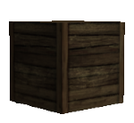

# Crates

{ width=100 loading=lazy }

[Crates](world-objects.md) are the main source of [Gold](gold.md) and
[Dyes](items/dyes.md) in *Age of Time*. This page explains how crate farms
spawn and respawn, followed by measured [drop rates](#crate-rates) for every
main crate-bearing area.

## Spawning logic

Each crate farm has a fixed number of crates. When one is broken, **only that
crate** starts its respawn timer: crates do not respawn together as a group.
For example, breaking two crates five seconds apart makes them return five
seconds apart.

| Zone | Crates | Respawn time (per crate) |
|---|---:|---|
| [Auric Fields](world/locations/auric-fields.md) | 20 | 1 second |
| [Red Crater](world/locations/red-crater.md) | 8 | 30 seconds |
| [Volcano](world/locations/volcano.md) | 5 ⚠️ | 20 seconds |
| [Woods](world/locations/woods.md) | 30 ⚠️ | 1 second |
| [Swamp](world/locations/swamp.md) | 10 | 1 second |
| [Blue Hill](world/locations/blue-hill.md) | 10 | 1 second |

!!! bug "Woods and Volcano crates can permanently disappear"
    In both the Woods and Volcano, a crate can fail to be placed when the
    server starts or when a broken crate tries to respawn. The spawner makes up
    to **100 placement attempts**, but gives up once those attempts are
    exhausted; the crate is then lost and the area's active crate count can
    permanently decrease. Treat the listed counts as starting/max counts rather
    than a guarantee of how many crates are currently available.

### Where a crate can appear

Each farm has a single spawner that places crates in a horizontal circle around
it. The radius below is the configured placement radius.

| Zone | Spawn radius | Grid spacing | Farming note |
|---|---:|---:|---|
| Auric Fields | 100 | 2.0 | Large, mostly flat area |
| Swamp | 100 | 2.0 | Large, mostly flat area |
| Blue Hill | 50 | 1.0 | Flat, compact area |
| Red Crater | 50 | 1.0 | Flat, compact area |
| Woods | 65 | 1.3 | Maze layout changes at restart, so usable spots change too |
| Volcano | 10 | 0.2 | Very tight peak; crates often recur in the same places |

Crate positions are **not continuously random**. Each spawner uses a fixed
101 × 101 grid centred on itself, with the cells outside its circular radius
excluded. It selects a valid grid cell and places the crate there; crates do
not use physics or slide after spawning. If a cell is invalid, it tries another
one (up to 100 attempts). The grid spacing is always:

```
spawn radius / 50
```

Terrain and objects can make a grid cell unusable. This matters most in the
Woods and Volcano. Volcano has a small, stable set of usable cells, so crates
often pile up in the same footprints. The Woods maze changes every server
restart, so its usable cells—and therefore its repeated crate spots—are
dynamic; a percentage of valid spawn points from a multi-restart log would not
describe any one server. The flatter farms can use almost their entire grid, so
their crates are distributed much more widely.

## Crate Rates

The numbers below come from logging **1,853,882 crate breaks** (~9.7 million
gold) across all six main crate zones. Every crate break was recorded with its
exact gold piles, item drop, and dynamite, so the percentages are tight — the
biggest zones have 528k+ samples.

!!! warning "Data still being gathered"
    - [Level 1](world/locations/level-1.md) also contains crates, but **no
      drop data has been logged there yet**.
    - [Volcano](world/locations/volcano.md) and the
      [Woods](world/locations/woods.md) have smaller sample sizes (50k–57k
      crates) and need more data to fully hone their rates.

    This page will be updated as more data is collected.

### The standard loot table

Four zones — **Auric Fields, Blue Hill, Swamp, and the Woods** — share the
exact same loot table. Every crate rolls one of these outcomes:

| Outcome | Gold piles | Chance | Item? |
|:--------|:-----------|-------:|:------|
| 3 gold | 1+1+1 | ~50% | never |
| 7 gold | 1+1+5 | ~40% | never |
| 11 gold | 1+10 | ~9% | **almost always the zone's dye** |
| 100 gold (jackpot) | single 100 pile | ~1% | never |

Mean is about **6.25–6.35 gold per crate** in all four zones.

**Dyes ride the 11-gold crate.** In every standard zone, dyes drop *only*
from the 11-gold (1+10) crate, and that crate almost always includes one
(92–98% of the time). The split is roughly **2:1 normal vs bright**:

| Zone | Normal dye | Bright dye | Any dye (per crate) |
|:-----|:-----------|:-----------|--------------------:|
| [Auric Fields](world/locations/auric-fields.md) | Yellow — 6.2% | Bright Yellow — 3.6% | 9.8% |
| [Blue Hill](world/locations/blue-hill.md) | Blue — 5.2% | Bright Blue — 2.6% | 7.8% |
| [Swamp](world/locations/swamp.md) | Cyan — 5.7% | Bright Cyan — 2.8% | 8.6% |
| [Woods](world/locations/woods.md) | Green — 5.7% | Bright Green — 2.8% | 8.5% |

**Dynamite is Auric Fields only.** 0.93% of Auric crates (~1 in 107) spawn
lit dynamite and drop nothing else. In 1.85 million crate breaks, no other
zone ever produced dynamite.

### Red Crater — a completely different table

[Red Crater](world/locations/red-crater.md) doesn't use the standard table at
all (590,687 crates logged):

| Outcome | Chance |
|:--------|-------:|
| 3 gold (1+1+1) | 52.6% |
| 1 gold (single pile) | 42.1% |
| 0 gold + **Red Dye** | 1.6% |
| 0 gold + **Bright Red Dye** | 1.6% |
| 100 gold (jackpot) | 1.1% |
| 0 gold, completely empty | 1.0% |

- There is **no 7 or 11 gold tier** — mean is only **~3.1 gold/crate**, less
  than half of any other zone.
- **Dyes come in gold-less crates** instead of riding a gold tier, and the
  Red/Bright Red split is ~50/50 rather than 2:1.
- It's the only zone with truly **empty crates** (~1%).

### Volcano — no jackpot, three dyes

[Volcano](world/locations/volcano.md) is standard-ish but with two twists
(50,062 crates logged):

| Outcome | Chance |
|:--------|-------:|
| 3 gold (1+1+1) | 50.2% |
| 7 gold (1+1+5) | 40.2% |
| 11 gold + **Black Dye** | 5.1% |
| 11 gold + **Magenta Dye** | 2.7% |
| 0 gold + **Pitch Black Dye** | 0.8% |
| 11 gold, no item | 0.8% |
| 0 gold, empty | 0.3% |

- **The 100-gold jackpot does not exist in Volcano** — zero in 50k+ breaks.
  Mean is 5.26 gold/crate.
- It's the only zone with **three dye types**: Black and Magenta on the
  11-gold crate, plus rare **Pitch Black Dye** in its own gold-less crate
  (~1 in 125 crates — the rarest dye per crate in the game).

!!! note "What about Orange Dye?"
    **Orange Dye does not drop from Volcano crates**, despite being
    historically credited to them — it did not appear once in 50k+ logged
    breaks. Where it actually comes from is unknown; the unlogged
    [Level 1](world/locations/level-1.md) crates are one possibility, but
    there is no data for that yet.

### Per-zone sample sizes

| Zone | Crates logged | Mean gold/crate | Jackpot rate |
|:-----|--------------:|----------------:|-------------:|
| [Red Crater](world/locations/red-crater.md) | 590,687 | 3.07 | 1.07% |
| [Auric Fields](world/locations/auric-fields.md) | 528,177 | 6.34 | 0.99% |
| [Swamp](world/locations/swamp.md) | 316,224 | 6.26 | 0.97% |
| [Blue Hill](world/locations/blue-hill.md) | 311,864 | 6.25 | 1.00% |
| [Woods](world/locations/woods.md) | 56,868 | 6.28 | 1.00% |
| [Volcano](world/locations/volcano.md) | 50,062 | 5.26 | none |

### TL;DR for farmers

- Gold per crate is basically identical everywhere (~6.3) except Volcano
  (5.26, no jackpot) and Red Crater (3.1). **Where you farm is about crate
  count and respawn speed, not the loot table.**
- Best gold: **[Auric Fields](world/locations/auric-fields.md)** and
  **[the Woods](world/locations/woods.md)** — 20–30 crates on 1-second
  individual respawns.
