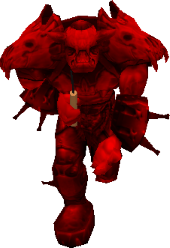
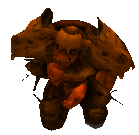
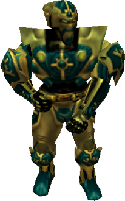
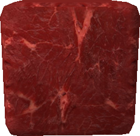

# Enemies

Hostile creatures and other dangers found in *Age of Time*.

- { width=96 }

    **Orc**

    The standard enemy. Moves slowly. Drops Gold.

- { width=96 }

    **Dynamite Orc**

    A red Orc that throws Dynamite. Drops two or three sticks of Dynamite and
    has a chance to drop lit Dynamite.

- { width=96 }

    **Rocket Orc**

    A small orange Orc. Moves very quickly and one-shots most of the time. Drops Gold.

- { width=96 }

    **Imp**

    A small green Orc found in the Woods. Fires bolts; drops Exploding and Steel Bolts.

- **Fire Orc**

    A red Orc that uses Fire magic. Only spawns in the Volcano. Drops two or
    three sticks of Dynamite and has a chance to drop lit Dynamite.

- { width=96 }

    **Sea Monster**

    A blue Orc that only spawns in water. Extremely tough. Drops Steel Bolts
    and can also drop Blue Potions. Sea Monsters override other spawn tables
    as long as you're in water, even inside nominally safe zones. They
    instantly kill players on contact, cannot walk on land, and normally only
    reach land if a player knocks one there with a shield effect.

- { width=96 }

    **Zombie**

    A gray, skinny Orc. Slightly fast but weak. Drops Gold.

- { width=96 }

    **Bunny**

    A tiny red Orc. Very slow. Drops Gold.

- { width=96 }

    **Knight**

    A lanky Orc-like enemy that shoots bolts. Drops Gold.

- { width=96 }

    **Meat Cube**

    A slow red cube. Larger ones split into four smaller ones. Drops Gold.

- { width=96 }

    **Blue Slime**

    A quick blue cube that only spawns near the Beach House. Drops Gold.

- **Horses**

    A creature you can ride. Not really an enemy, but you can kill them.

- **Players**

    Other players. Usually extremely hard to evade or kill.

## Spawning mechanics

Most enemies appear through the game's normal **around-the-player spawning**:
the server periodically spawns enemies near each player as they move through
the world. This system has two caps:

- **Per player:** up to **3** enemies spawned around each player at once.
  An enemy is believed to count against the player it is **currently
  tracking** — it starts on the player it spawned around, and is reassigned
  to another player if it switches to chasing them, freeing a slot for the
  original player.
- **Global:** at most **50** spawned enemy NPCs can exist in the world at
  once, shared by the whole server. Once the world holds 50, around-the-player
  spawning stops for **everyone** until some are killed or despawn.

Around-the-player enemies also **despawn** on their own: an enemy that loses
track of any player wanders for a set time and is then removed. An enemy
only persists as long as it has a player to track.

[`RoomTrigger`](world/orc-spawn-triggers.md) spawns (the
[Level 1](world/locations/level-1.md) and
[Level 2](world/locations/level-2.md) rooms, the
[Cave pit](world/orc-spawn-triggers.md#the-cave-pit), and the two
SwampBotZones) are exempt from the global cap when spawning — they always
spawn one Orc per player who enters, regardless of the world count — but the
Orcs they spawn **do** count toward the 50.

!!! note "How the caps were confirmed"
    Tested **2026-08** by parking four dead players in a Level 1 room while
    carry-teleport glitched to register as being in the Volcano, so Fire Orcs
    spawned around them in Level 1. Four **living** players were positioned at
    the top of the room as bait: each new Fire Orc focused one of them, and
    having a player to track kept the Orcs from wandering off and despawning.

    Orcs kept spawning around the dead players well past three apiece, until
    the world hit exactly **50** — at which point spawning stopped for the
    entire server, effectively a server-wide
    [Monster Spawn Break](reference/exploits/spawn-break.md). A player then
    entering a Level 1 room still spawned its Orc, confirming `RoomTrigger`s
    ignore the cap.

!!! question "Why the per-player cap never stopped the test"
    Two explanations have been offered for the dead players spawning far more
    than three Orcs each, and the difference has not been settled:

    - Enemies spawned around a **dead** player never count against that
      player's cap at all.
    - Each Orc counted against its dead spawner only until it began chasing a
      living bait player, at which point it was reassigned to that player and
      freed the dead player's slot for another spawn.
