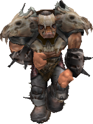
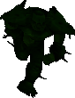
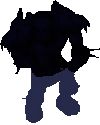
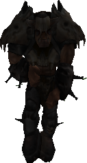
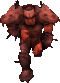
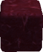

# Enemies

Hostile creatures and other dangers found in *Age of Time*.

- { width=96 }

    **Orc**

    The standard enemy. Moves slowly. Drops Gold.

- { width=96 }

    **Dynamite Orc**

    A red Orc that throws Dynamite. Drops two or three sticks of Dynamite and
    has a chance to drop lit Dynamite.

- { width=96 }

    **Rocket Orc**

    A small orange Orc. Moves very quickly and one-shots most of the time. Drops Gold.

- { width=96 }

    **Imp**

    A small green Orc found in the Woods. Fires bolts; drops Exploding and Steel Bolts.

- **Fire Orc**

    A red Orc that uses Fire magic — the same [Burn](magic.md#burn) spell
    players can cast, which reaches about 11.5 m. Only spawns in the Volcano. Drops two or
    three sticks of Dynamite and has a chance to drop lit Dynamite.

- { width=96 }

    **Sea Monster**

    A blue Orc that only spawns in water. Extremely tough. Drops Steel Bolts
    and can also drop Blue Potions. Sea Monsters override other spawn tables
    as long as you're in water, even inside nominally safe zones. They
    instantly kill players on contact, cannot walk on land, and normally only
    reach land if a player knocks one there with a shield effect.

- { width=96 }

    **Zombie**

    A gray, skinny Orc. Slightly fast but weak. Drops Gold.

- { width=96 }

    **Bunny**

    A tiny red Orc. Very slow. Drops Gold.

- { width=96 }

    **Knight**

    A lanky Orc-like enemy that shoots bolts. Drops Gold.

- { width=96 }

    **Meat Cube**

    A slow red cube. Larger ones split into four smaller ones. Drops Gold.

- { width=96 }

    **Blue Slime**

    A quick blue cube that only spawns near the Beach House. Drops Gold.

- **Horses**

    A creature you can ride. Not really an enemy, but you can kill them.

- **Players**

    Other players. Usually extremely hard to evade or kill.

## Fighting monsters

- The standard **Orc** has **100 health**, the same as a player: it takes
  four quick [sword](items/weapons.md#sword-combat) hits (30 damage each) to
  kill. Other monsters' health has not been measured.
- Monsters take [Dynamite](items/weapons.md#dynamite) damage and get pushed
  by the blast **exactly like players** — a stick inside about 5 m kills an
  Orc.
- **Hitting a monster gets its attention:** a hit from a sword, bolt, knife,
  spell or any other damaging attack makes it turn toward where the hit came
  from and start chasing you, even if it hadn't seen you. The
  [Police Baton](items/weapons.md#police-baton) is the exception (see below).
- Monsters never take damage from being slammed into walls or from falling,
  and surviving a Dynamite blast doesn't stun them.
- The [Police Baton](items/weapons.md#police-baton) does nothing useful
  against monsters. The hit puts stars over the Orc (for at most 10.4 s) and
  makes it play a strange falling-over animation on top of its normal
  movement, but it takes no damage, is not stunned, doesn't even notice the
  hit, and keeps chasing and attacking you. Hitting a monster is not a
  crime.
- A raised [Shield](items/weapons.md#shield) blocks a monster's contact
  damage, and the shield's metal has special effects against monsters:
  Copper freezes them, Zinc spins them around, Gold makes them drop gold
  (up to 10 piles per monster), Lead knocks them back, and Iron/Steel sparks
  hurt them. See
  [Blacksmith § Shield metal effects](npcs/blacksmith.md#shield-metal-effects)
  for the details.

## Spawning mechanics

Most enemies appear through the game's normal **around-the-player spawning**:
the server periodically spawns enemies near each player as they move through
the world. This system has two caps:

- **Per player:** up to **3** enemies spawned around each player at once.
  An enemy is believed to count against the player it is **currently
  tracking** — it starts on the player it spawned around, and is reassigned
  to another player if it switches to chasing them, freeing a slot for the
  original player.
- **Global:** at most **50** spawned enemy NPCs can exist in the world at
  once, shared by the whole server. Once the world holds 50, around-the-player
  spawning stops for **everyone** until some are killed or despawn.

Around-the-player enemies also **despawn** on their own: an enemy that loses
track of any player wanders for a set time and is then removed. An enemy
only persists as long as it has a player to track.

### Timer, placement and loitering

Measured **2026-11-24** with a dead player in the wilderness north of Port
Town (13 spawns over 10 minutes):

- **Timer:** every player gets a spawn check every **45 seconds** of server
  time (about 46.8 s on a real clock, since the server clock runs slightly
  slow). Every one of the 13 checks spawned an enemy — there was no random
  chance to skip.
- **Each player has their own timer:** with two players lying dead far
  apart, both got an enemy every 45 seconds, but always about 17.5 seconds
  apart — the timer runs separately for every player rather than once for
  the whole server.
- **Dead players count:** enemies keep spawning around a dead player's body.
- **Distance:** each enemy appears **5–10 m east or west and 5–10 m north or
  south** of the player (both at once), so never straight north, south, east
  or west; 7–13 m in total.
- **Which enemy:** north of Port Town the spawns were Orcs, Bunnies (an Orc
  shrunk to a fifth of its size), Meat Cubes of different sizes, and a
  Knight.
- **Despawning:** an enemy that never finds a target disappears about
  **30 seconds** after it spawns.
- **Loitering:** a wandering enemy turns to a random direction, walks for up
  to about **2.75 seconds** (at about 2.9 m/s), then stands still for a
  moment — usually 0.25–3.5 s, now and then 6–11 s — before turning and
  walking again. It does not head for the player or stay near where it
  spawned.
- **Coprolite:** full-size Orcs, Dynamite Orcs and Knights randomly drop
  **Coprolite** ore exactly where they stand, at the moment they stop
  walking (Bunnies and Meat Cubes never do). It works out to about one or
  two per monster before it despawns, sometimes two at the same stop or one
  right after spawning. The same full-size monsters also sometimes stand
  still for a long time (5–11 seconds) between walks.

### How each enemy fights

Measured **2026-11-24** by letting monsters kill a 100-health player north
of Port Town 25 times:

| Enemy | Damage | How it attacks |
|---|---|---|
| Orc | 5 per hit (20 hits kill) | Charges straight at you at 6–8 m/s, hitting a quarter second apart. As soon as it stops getting any closer — touching you, or blocked by a wall — it plays **Hate** (after about 0.4 s), stands a moment, runs off in a **random direction** for about a second, then charges again. Behind a wall it keeps doing this every 3–4 s. |
| Small Meat-Cube | 5 per hop | Hops at you — one hop about every half second, ~0.9 m each — and keeps hopping in place on top of you, one hit per hop. |
| Medium Meat-Cube | 7 per hop (15 hits kill) | Same hopping attack. |
| Bunny | not measured | Hops at you like a Meat Cube. |
| Knight | 10 per shot (10 shots kill) | Walks in at ~4.3 m/s and starts shooting from about **3 m**, a shot every half second, closing until it touches you. Touching it does no damage. |
| Dynamite Orc | one blast kills | Charges at ~7.6 m/s and drops a lit stick of Dynamite once it is within about **3.5 m**, and another 1.5 s later. The blast comes about 2.5 s after the first drop. Touching it does no damage, and its own blasts don't hurt it. |

- Meat Cubes and Bunnies **walk** while loitering and only **hop** once they
  are after you.
- **Alarm** (the "!" emote) plays when an Orc, Dynamite Orc or Knight
  notices you — Meat Cubes and Bunnies never play it. An Orc that notices
  you when you are already right next to it plays **WTF** first, then Alarm.
- Every monster that was after you plays **Love** just after you die.
- Kill messages: "was killed by an Orc", "a Small Meat-Cube", "a Medium
  Meat-Cube", "a Knight"; a Dynamite Orc's blast reads "a monster".
- A monster that has fought you does not vanish after 30 seconds — it can
  wait by your body and attack again when you come back.

[`RoomTrigger`](world/orc-spawn-triggers.md) spawns (the
[Level 1](world/locations/level-1.md) and
[Level 2](world/locations/level-2.md) rooms, the
[Cave pit](world/orc-spawn-triggers.md#the-cave-pit), and the two
SwampBotZones) are exempt from the global cap when spawning — they always
spawn one Orc per player who enters, regardless of the world count — but the
Orcs they spawn **do** count toward the 50.

!!! note "How the caps were confirmed"
    Tested **2026-08** by parking four dead players in a Level 1 room while
    carry-teleport glitched to register as being in the Volcano, so Fire Orcs
    spawned around them in Level 1. Four **living** players were positioned at
    the top of the room as bait: each new Fire Orc focused one of them, and
    having a player to track kept the Orcs from wandering off and despawning.

    Orcs kept spawning around the dead players well past three apiece, until
    the world hit exactly **50** — at which point spawning stopped for the
    entire server, effectively a server-wide
    [Monster Spawn Break](reference/exploits/spawn-break.md). A player then
    entering a Level 1 room still spawned its Orc, confirming `RoomTrigger`s
    ignore the cap.

!!! question "Why the per-player cap never stopped the test"
    Two explanations have been offered for the dead players spawning far more
    than three Orcs each, and the difference has not been settled:

    - Enemies spawned around a **dead** player never count against that
      player's cap at all.
    - Each Orc counted against its dead spawner only until it began chasing a
      living bait player, at which point it was reassigned to that player and
      freed the dead player's slot for another spawn.
