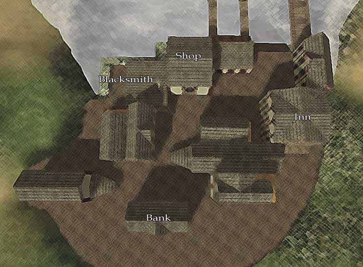
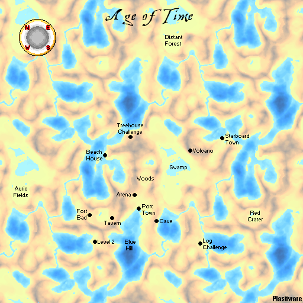

# Getting Started

Welcome to *Age of Time* — a small, multiplayer action/RPG built on the Torque
Engine by Eric "Badspot" Hartman, released in 2005 and still playable today.

## Download & install

The current public release is **Version 30 (5/3/2024)**.

[:material-download: Download v0030 from ageoftime.com](https://www.ageoftime.com/files/AgeOfTime-30.exe){ .md-button .md-button--primary }

1. Grab the installer from the link above (or the
   [official downloads page](https://www.ageoftime.com/download.html)).
2. Run the installer and let it extract the game files.
3. Launch `AgeOfTime.exe` from the install folder.6

!!! warning "Older releases"
    Older builds shipped as `.rar` archives that required WinRAR or WinZIP to
    extract. The current installer handles this for you.

## Creating a character

The **Create Character** screen lists the rules for names and passwords:

**Name**

- At least 2 and at most 30 characters.
- Letters only, plus `'` and `-` (no numbers or other symbols).
- Must contain at least one letter.
- No more than one space in a row.

**Password**

- At least 6 characters.
- It also can't be the word `password` (the game refuses it with
  *Your password cannot be "password"*).

A name that breaks the rules is refused with *"Invalid Name"*.

## Controls

These are the default bindings shipped with the game. The full list is
defined in `base/client/config.cs` and can be remapped from the in-game
options menu (<kbd>Ctrl</kbd>+<kbd>O</kbd>).

### Movement

| Key | Action |
|---|---|
| <kbd>W</kbd> | Move forward |
| <kbd>A</kbd> | Strafe left |
| <kbd>S</kbd> | Move backward |
| <kbd>D</kbd> | Strafe right |
| <kbd>Space</kbd> | Jump |
| <kbd>Left Shift</kbd> | Walk (hold) |
| <kbd>C</kbd> | Crouch / swim down / disconnect from a hook |
| <kbd>Ctrl</kbd>+<kbd>W</kbd> | Auto-walk forward |
| <kbd>←</kbd> / <kbd>→</kbd> | Turn left / turn right |

### Combat & interaction

| Key | Action |
|---|---|
| <kbd>Left Mouse</kbd> | Attack |
| <kbd>Right Mouse</kbd> | Shield |
| <kbd>E</kbd> | Action (interact, talk, pick up, buy) |
| <kbd>Ctrl</kbd>+<kbd>E</kbd> | Stop action |
| <kbd>Ctrl</kbd>+<kbd>K</kbd> | [Suicide](death.md) |

### Inventory & menus

| Key | Action |
|---|---|
| <kbd>I</kbd> | Open inventory |
| <kbd>1</kbd>–<kbd>9</kbd>, <kbd>0</kbd> | Inventory quick slots 1–10 |
| <kbd>O</kbd> | Open status window |
| <kbd>V</kbd> | Open the [Voice / Action menu](voice-menu.md) |

### Camera & view

| Key | Action |
|---|---|
| <kbd>Mouse</kbd> | Look (yaw / pitch) |
| <kbd>Tab</kbd> | Toggle 1st / 3rd person |
| <kbd>Z</kbd> | Toggle free look |
| <kbd>F</kbd> | Toggle zoom |
| <kbd>R</kbd> | Set zoom field-of-view |
| <kbd>↑</kbd> / <kbd>↓</kbd> | Pan camera up / down |
| <kbd>Alt</kbd>+<kbd>C</kbd> | Toggle detached camera |
| <kbd>F7</kbd> | Drop player at camera (detached-camera mode) |
| <kbd>F8</kbd> | Drop camera at player (detached-camera mode). Enemy NPCs do not notice you while in this camera — see [Orbit camera stealth](tips.md#orbit-camera-stealth) |

### Chat & HUD

| Key | Action |
|---|---|
| <kbd>T</kbd> | Toggle global chat |
| <kbd>Y</kbd> | Local-area chat |
| <kbd>P</kbd> | Resize the chat HUD |
| <kbd>Page Up</kbd> / <kbd>Page Down</kbd> | Scroll chat history |
| <kbd>F2</kbd> | Show player list |

#### How chat works

- **Global chat** (<kbd>T</kbd>) goes to everyone online. Messages are cut
  to **120 characters**.
- **Local chat** (<kbd>Y</kbd>) shows as *"Name says, "…""* to players within
  about **15 m** of you. The server searches a 15 m radius and counts a player
  as soon as the edge of their body is inside it, so the reach is a little more
  than 15 m between the two players: about 15.3 m along the compass diagonals
  (NE–SW, SE–NW) and up to about 15.6 m north–south or east–west. Walls
  don't block it: people on the other side of a wall still hear you. Long local
  lines are cut at about 255 characters, closing quote included.
- The server removes `"` `~` and `` ` `` from both kinds of chat, along with
  accented letters (é, ü, ñ …) and any hidden control characters, so colour
  codes and line breaks can't be slipped into a message.
- **Flood protection:** global and local chat share one limit. Each message
  counts for 10 seconds, and a 5th message while 4 are counting blocks you for
  10 seconds with *"FLOOD PROTECTION: You must wait another 10 seconds."*
- **In jail** you can't use global chat (*"You cannot chat globally from
  jail."*), but local chat still works.
- **While stunned** by a police baton (also while being carried) you can't use
  global chat either (*"You cannot chat globally while stunned."*). Local chat
  still works, so you can still talk to the officer.
- You can chat normally while dead or asleep, but not from the character
  screen after `/logout`: anything you type there is silently thrown away.
- Only global chat can get you [chat crimes](police-mechanics.md#chat-crimes-in-detail)
  (cursing, all caps, spamming).
- Anything starting with `/` is sent as a [slash command](commands.md). An
  unknown command does nothing; there's no error message.

### System

| Key | Action |
|---|---|
| <kbd>Ctrl</kbd>+<kbd>O</kbd> | Options menu |
| <kbd>Ctrl</kbd>+<kbd>P</kbd> | Take a screenshot |
| <kbd>F3</kbd> | Start recording a demo |
| <kbd>F4</kbd> | Stop recording a demo |
| <kbd>Ctrl</kbd>+<kbd>A</kbd> | Open admin window (server admins only) |
| <kbd>Esc</kbd> | Quit to the main menu |

## Interacting with the world

Look at something and press <kbd>E</kbd> to interact. Press <kbd>Ctrl</kbd>+<kbd>E</kbd>
to stop.

- **Rescuing players** — pick up a dead player. Drop them
  (<kbd>Ctrl</kbd>+<kbd>E</kbd>) on a bed to bring them back to life. The
  player can resist being rescued by pressing jump (default <kbd>Space</kbd>).
- **Open doors** — look at a door and press <kbd>E</kbd>. You can reach a door
  from up to about **3.5 m** away (measured from your eyes to the door).
- **Buy things** — the price appears above an item. Look at it and press <kbd>E</kbd>
  to purchase.

## Maps

- { loading=lazy }

    **Port Town** — the starting town and central hub.

- { loading=lazy }

    **Overworld** — the world surrounding Port Town.

A more detailed community-made map is available on the [Areas](areas.md) page.

!!! note
    This maps section is archaic and due for a fuller refresh.

## Where to next?

- Browse [Items](items/index.md) for weapons, dyes, materials, and utility items.
- Check the [Magic](magic.md) menu and [Slash Commands](commands.md).
- Tour the world on the [Areas](areas.md) page.
- Read up on [Enemies](enemies.md) you'll run into.
- Pick up community lore in [Tips & Secrets](tips.md).
