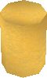
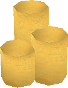
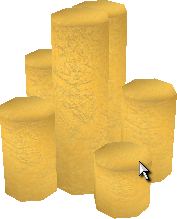
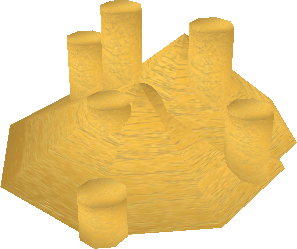
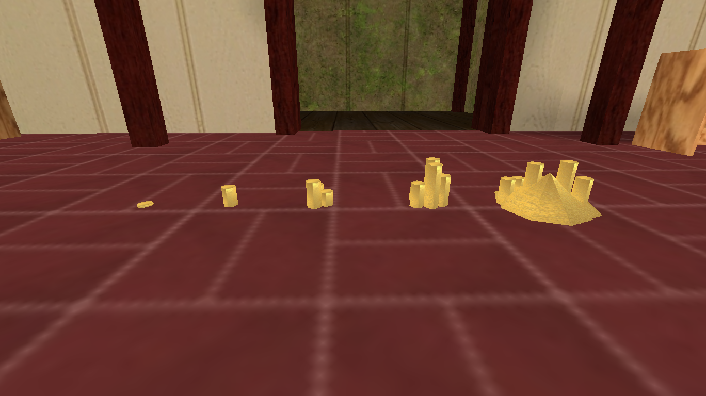

# Gold

Gold is the currency of *Age of Time*. It is earned by killing monsters,
breaking [Crates](world-objects.md#resource-nodes-and-breakables), selling at
shops, and looting other players, and it is spent at the
[Blacksmith](npcs/blacksmith.md), shops, and the [Banker](npcs/banker.md).

When gold is dropped on the ground — whether by you with
[`/dropgold`](commands.md#actions), by a dying player, or by a slain monster —
it appears as a **physical pile** that anyone can walk over to pick up.

`/dropgold` is rate-limited to roughly **one drop per second**; issuing it
faster than that simply does nothing until the next drop is allowed. Bank
deposits and withdrawals have no such limit.

!!! note "Coins vs. the Gold ingot"
    The currency described here is separate from the
    [Gold ingot](items/metals.md) crafting material, which is a normal
    inventory item smithed from Copper.

## Gold pile sizes

The pile model that renders depends on how much gold is in the stack. Larger
amounts use chunkier shapes so you can roughly judge a pile's value at a
glance.

<div class="grid cards" markdown>

- { width=96 loading=lazy }

    **1–2 gold** — a single small coin.

    `base/data/shapes/player/golda.dts`

- { width=96 loading=lazy }

    **3–19 gold** — a short single stack.

    `base/data/shapes/player/goldb.dts`

- { width=96 loading=lazy }

    **20–199 gold** — a small cluster of stacks.

    `base/data/shapes/player/goldC.dts`

- { width=96 loading=lazy }

    **200–1999 gold** — a tall multi-column pile.

    `base/data/shapes/player/goldD.dts`

- { width=96 loading=lazy }

    **2000+ gold** — the largest model, and the only one that **scales**
    with the amount (see below).

    `base/data/shapes/player/goldE.dts`

</div>

| Pile | Gold amount | Shape file |
|---|---|---|
| A | 1 – 2 | `base/data/shapes/player/golda.dts` |
| B | 3 – 19 | `base/data/shapes/player/goldb.dts` |
| C | 20 – 199 | `base/data/shapes/player/goldC.dts` |
| D | 200 – 1999 | `base/data/shapes/player/goldD.dts` |
| E | 2000+ | `base/data/shapes/player/goldE.dts` |

The five piles side by side, from smallest to largest:

{ loading=lazy }

## Scaling of large piles

The first four piles (A–D) are fixed-size models. The **E** pile used for
2000 gold and above grows with the amount, so a truly massive hoard towers
over a merely large one.

The model's scale increases with the square root of the amount:

```
scale = sqrt(gold / 2000)
```

Or, solving for the amount from a given scale:

```
gold = scale² × 2000
```

At exactly 2000 gold the scale is `1`. Because scale grows with the square
root, the pile's visual size grows much more slowly than its value — it takes
**4×** the gold to make the pile twice as tall.

## Picking up gold

Walking over a gold pile adds it to the gold you are carrying. Carried gold is
**dropped on death** at the spot where you fall, so banking it is the only way
to keep it safe — see [Death & Respawning](death.md) and the
[Banker](npcs/banker.md).

!!! note "Piles count as dropped items"
    A gold pile is an item like any other, so it counts toward the world's
    global limit of **1001 [dropped items](world-objects.md#dropped-items)**.
    Piles are evicted oldest-first once the world goes over that cap, and
    dropping enough gold will wipe out unrelated items lying elsewhere on the
    map.

## Large balances (1,000,000 and above)

The server stores gold as text with only **six significant digits**. Below
1,000,000 that is enough to hold an exact number, so gold behaves normally.
At 1,000,000 and above it is not, and balances get silently rounded on
**every** change.

The size of that rounding step grows with your balance:

| Balance | Gold is rounded to the nearest |
|---|---:|
| 1,000,000 – 9,999,990 | 10 |
| 10,000,000 – 99,999,900 | 100 |
| 100,000,000 – 999,999,000 | 1,000 |

The step keeps growing by a factor of ten with each digit added, and each
bracket ends at the largest balance the server can actually store in it — one
more gold rounds up into the next.

Two consequences matter in practice.

**Small amounts vanish or double.** Any gain or loss smaller than half the
rounding step disappears into the rounding. Picking up 1 gold at a 3,000,000
balance may add nothing at all — or 10. This cuts both ways and is the basis
of the [Money Printer](reference/exploits/money-printer.md) exploit.

**Dropping more gold than you have destroys it.** With 1,000,000 or more,
[`/dropgold`](commands.md#actions) with an amount above your balance deducts
your **whole balance** but only creates a pile worth the **leading digit** of
it. Dropping 9,000,000 while holding 2,500,000 leaves a **2 gold** pile and
takes the entire 2,500,000. The rest is gone for good — it is not sitting in
another pile somewhere.

It really is the leading digit and not a count of millions, so the loss gets
proportionally worse the richer you are:

| Balance | Pile you get | Gold destroyed |
|---:|---:|---:|
| 2,500,000 | 2 | 2,499,998 |
| 8,500,000 | 8 | 8,499,992 |
| 45,000,000 | 4 | 44,999,996 |

!!! danger "Never over-drop a large balance"
    This is the fastest way to lose a fortune in *Age of Time*. Below
    1,000,000 the same command is harmless (it just clamps to what you have),
    which is why the behavior catches people out. Bank large sums instead of
    carrying them, and never type an amount you do not actually hold.

## See also

- [Money Printer](reference/exploits/money-printer.md) — minting free gold
  from the rounding on large balances.
- [`/dropgold`](commands.md#actions) — drop a specific amount of gold.
- [`/bankdeposit`](npcs/banker.md#depositing-with-bankdeposit) — deposit gold
  from chat, even through walls.
- [Banker](npcs/banker.md) — deposit gold so it survives death.
- [Death & Respawning](death.md) — how carried gold is lost when you die.
- [World Objects](world-objects.md) — Crates and other sources of gold.
- [Crate Rates](crate-rates.md#crate-rates) — measured crate drop rates and the best
  zones to farm.
