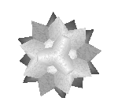

# Fiber & Fiber Plants

{ width=96 loading=lazy }

**Fiber** is a raw material used to make [Cloth](cloth.md). It is obtained
from [shrubs](../world-objects.md#resource-nodes-and-breakables), but can also
be grown into more Fiber: throw a Fiber onto the ground to plant a Fiber plant.

## At a glance

| | |
|---|---|
| Seed | Throw **1 Fiber** onto a surface |
| Time to maturity | **30–31 minutes** in real time |
| Harvest | Destroy a fully grown plant |
| Yield | **2–3 Fiber** |
| Net result | **+1 to +2 Fiber** per successful crop |
| Regrowth | None — harvest removes the plant; replant to start again |
| Player-grown limit | **500** plants across the whole world |
| World maximum | **510** plants (500 player-grown + 10 naturally spawned) |

!!! warning "Do not harvest early"
    An immature Fiber plant drops **nothing** when destroyed, including the
    Fiber used to plant it. Wait until it is fully grown before harvesting.

## Growing Fiber

1. Equip a Fiber and throw it onto a suitable surface.
2. A small Fiber plant appears and starts growing immediately.
3. Leave it for about **31 minutes**. Plants continue growing while no one is
   nearby.
4. When the plant is fully grown, destroy it to receive **2–3 Fiber**. A
   plant has 30 health: one sword hit or two Ball spells.
5. Replant one of the harvested Fiber to begin the next crop.

Each plant is single-use. Harvesting removes it completely; it will not grow
back in the same spot on its own.

!!! warning "Global Fiber-plant limit"
    The server allows at most **500 player-grown Fiber plants** at once, shared
    by everyone in the world. Once that limit is reached, throwing another
    Fiber makes the thrown item despawn without placing a plant. The server
    reports: `You can't plant any more fiber. (global limit)`

    Separately, a `DestructableSpawner` keeps **10 randomly placed** Fiber
    plants in the world. These wild plants are always fully grown: when you
    harvest one, a new ripe one appears about a second later somewhere else
    on the map. These do not count against the player-grown limit, so
    the absolute maximum is **510 Fiber plants** at once.

## Throwing and where plants grow

Hold the attack button to charge the throw and release it to throw. A quick
tap throws the Fiber at about 6.4 m/s. Every bit of extra holding adds speed,
up to the maximum of 40 m/s after about 3 seconds, so you can lob a seed a long
way. It flies straight where you're looking and sticks to almost anything it
hits. Your own movement is added to the throw: throwing while running forward
sends it further, and throwing while backing up shortens it. Every throw uses up one Fiber, even if no plant grows.

About 3 seconds after the throw, a plant grows **exactly where the Fiber
stopped**, but only if it stuck to:

- the ground, including steep slopes up to about **80°**, and even just
  under water;
- a building floor or other walkable building surface.

Nothing grows, and the Fiber is lost, if it stuck to a **wall**, a **tree**,
a **crate or other object**, or a **person or NPC**. Fiber thrown at a Large
Rock flies straight through it. There's no message when a throw fails.

What actually decides it: the server checks straight down from where the
Fiber stopped, and the plant only grows if there's ground or a building
floor within **30 cm** below it. A Fiber stuck to a slope steeper than about
80° hangs too far above the ground beneath it, so it fails. Near a ledge or a
dip it can go either way, because what counts is the ground directly below.

Plants don't need any space: they can grow right next to each other, a few
centimetres apart.

## How to tell when it is ready

A ripe plant has both of these signs:

- Its size has reached its full scale (`1 1 1`).
- Its stalks have changed from green to **brown**.

The change is discrete, not gradual at the end: a plant one growth step short
of full size is still unripe and yields nothing. If you can inspect its scale,
only `1 1 1` is safe to harvest; do not rely on an almost-full appearance.

## Timing and growth stages

Fiber plants grow one stage at a time on a shared server-wide growth tick. The
tick is designed to run every server minute, which was measured as about
**62.4 seconds of real time** (the [server clock](../reference/server-clock.md)
runs about 4% slow). A plant becomes ripe on the 30th tick after it
is planted.

Because planting can happen anywhere between ticks, a new plant takes about
**30.16 to 31.20 minutes** to mature (about **30.7 minutes on average**).
Plants planted at different times can therefore finish together when the next
shared tick arrives.

| Visible scale | What it means | Approx. time remaining |
|---:|---|---:|
| `0.1` | New plant; the first few stages look identical | 28.1–31.2 min |
| `0.5` | About halfway through growth | 15.6 min |
| `0.9` | Nearly ready | 3.1 min |
| `1 1 1` | Fully grown and harvestable | Ready now |

!!! tip "Planning a Fiber farm"
    Since every plant uses the same tick, seeing *any* plant advance a stage
    tells you when the next stage will occur for the whole farm. Outside the
    initial `0.1` stage, a plant's scale maps directly to its progress in
    1/30 increments.

## Farming strategy

Replanting one Fiber from each harvest turns every successful crop into a net
gain of 1–2 Fiber. In practice, expanding the farm is limited by the room and
time needed to plant and harvest, rather than by a per-plant respawn timer.

For example, reinvesting every harvested Fiber produces roughly 2–3 times as
many plants per ~31-minute cycle. Once the farm is large enough, staggered
planting makes regular harvests easier to manage.

!!! warning "Harvest large farms in batches"
    The world has a global limit of **1,001 [dropped items](../world-objects.md#dropped-items)**.
    Each harvested Fiber plant creates 2–3 separate Fiber drops, so breaking
    all 500 plants can create up to 1,500 items and evict the oldest items
    already on the ground.

    To stay below the cap from Fiber alone, break **no more than 333 plants at
    once** (at most 999 drops), collect the Fiber, then continue. Use smaller
    batches if other dropped items are already in the world, since the limit is
    shared globally.

## Technical details

The Fiber plant is a `StaticShape` using
`base/data/shapes/rock/bush1.dts`. Its growth scale is quantised to 30 stages:
after the initial display clamp, each tick adds `1/30` to the displayed scale.
The initial `0.1` scale covers several early stages, which is why it cannot
give an exact remaining-time estimate. Fully grown plants remain ripe until
they are harvested.

The 62.4-second real-time tick and the maturity window above were measured
from 54 observed growth ticks over about 75 minutes. The exact probability of
a 2-Fiber versus 3-Fiber harvest has not yet been measured.

## See also

- [Cloth](cloth.md) — Fiber recipes and cloth patterns.
- [World Objects](../world-objects.md#resource-nodes-and-breakables) — shrubs
  and other harvestable world objects.
