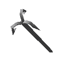

# Movement Items

Movement items are inventory tools that primarily change how you travel around
the map.

- { width=64 } **Hook** — reward for completing [Level 1](../world/locations/level-1.md). Allows acrobatic grappling around the map, but lasts only about **15 seconds** after being fired (15.6 s on a stopwatch). It is thrown at **20 m/s**, so its shot drops off faster and does not reach as far as the Golden Hook.
- { width=64 } **Golden Hook** — reward for completing the [Log Challenge](../world/locations/log-challenge.md). A stronger version of the Hook, thrown at **40 m/s** (twice as fast, so it flies much further and flatter) and lasting about **1 minute 2 seconds** after being fired. The thrown golden hook glows yellow.
- { width=64 } **Insta-Horse** — sold in the [Port Town Shop](../world/locations/port-town.md#shop). Spawns a Horse, but can only be used outside of safe zones.

## How the hook works

Measured on the official server (2026-11-23).

- **Throwing:** the hook flies from your hand at its throw speed plus your own movement. Running or jumping
  while you throw adds your full speed to it in that direction.
- **Sticking:** it sticks to whatever it hits first — ground, buildings, trees, rocks, even other players.
  It sticks to almost anything it hits, but a hook that only grazes a surface at a very shallow angle
  bounces off instead.
- **The rare bounce:** now and then a hook bounces straight back toward you instead of sticking, at any
  throwing angle. Tested on the official server (2026-11-25): the hook flies at 40 m/s and checks its path
  in steps of about 1.3 m. The game counts the last few millimetres above a surface (about 5 mm) as already
  inside it. So if one step happens to stop just above a floor or wall, the next step "starts inside" and the
  game treats the hit as perfectly head-on. A perfectly head-on hit is then a coin flip (decided by tiny
  rounding differences, about half the time each way) between sticking and bouncing. When it bounces it goes
  straight back the way it came at a fifth of its speed, which is why a bounced hook lands near your feet.
  Stopping within those few millimetres is rare (roughly 1 throw in a few hundred), and the same throw
  repeated exactly the same way gives the same result.
- **Rope length:** fixed when the hook sticks: the distance from your feet to the hook, rounded **down**
  to a whole metre. Standing still, the rope stays slack until you are further than that from the hook.
- **Swinging:** while the rope is tight, you swing around the hook and your body tilts to hang from the
  rope. Holding a movement key pushes you along the swing.
- **The rope seems to stretch:** while you swing you drift a little further from the hook (a few centimetres
  per swing). The rope's length never actually changes: the game stops you moving away from the hook but
  never pulls you back in, so small rounding errors add up. Move closer to the hook and you are back within
  the original length. At the end of a swing you can also creep slowly up and outward for several seconds
  instead of swinging straight back, for example when sliding along a wall.
- **Letting go:** crouch to release the rope. Throwing again replaces your old hook, and the rope lets go
  by itself when the hook times out (about 15 s for the Hook, about 1 minute for the Golden Hook).
- You only ever have one hook out at a time.
