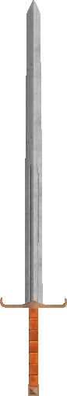
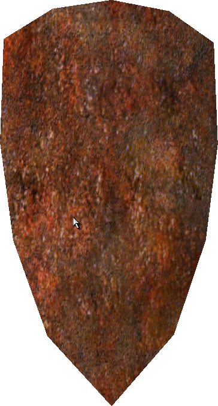
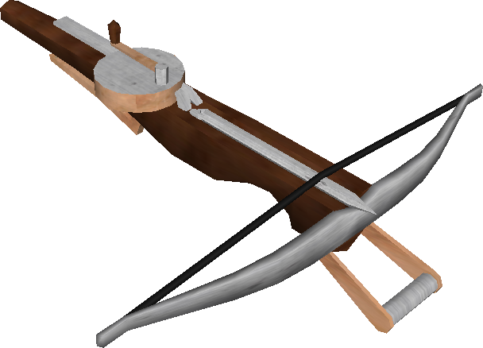
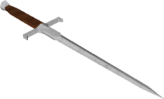
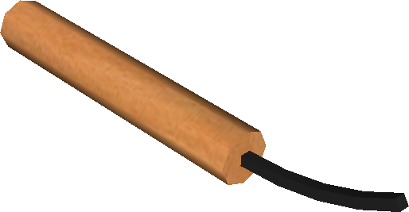
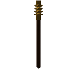
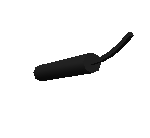
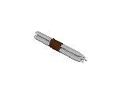
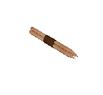
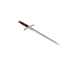

# Weapons

Weapons in *Age of Time* include crafted gear, shop-bought ranged weapons, and
a few special-purpose combat items.

!!! note "Health and damage numbers"
    Players and Orcs both have **100 health**, so the damage numbers on this
    page are also percentages of a full health bar. The numbers were measured
    on the official server in **2026-11**.

## Sword

{ width=100 loading=lazy }

The standard offensive item. All swords have the same damage output.

- **Crafted from:** 5 Metal, 2 other Metal, 1 Wood, 900 Gold
- No matter what Metal or Wood is used, all swords deal the same damage and
  do not gain special metal effects.
- **Free starter sword:** new players can obtain a basic **Crap Sword** at no
  cost from the [Sword Giver](../npcs/sword-giver.md) NPC near the Port Town
  docks (the spawn point).
- The Crap Sword is not weaker than other swords; it has the same damage as
  every other sword.
- You keep your Crap Sword when you die, because death normally drops **Gold**
  rather than your inventory. The one notable exception here is the **Rusty
  Sword**, which is a quest item and cannot be dropped at all. The free Crap
  Sword giveaway only happens once per character.

### Sword combat

| Property | Value |
|---|---|
| Damage (quick swing) | **30** |
| Damage (charged swing) | **50** |
| Reach | **2.5 m** |
| Hit arc | **30°** either side of the way you face (60° total) |
| Time between swings | about **1.5 s** |
| Knockback | None |

- The hit lands the instant the swing starts. Anything within 2.5 m and inside
  the arc is hit; only the direction your body faces counts, so looking up or
  down does not change what you hit.
- **Charged swing:** hold the attack button for more than **1 second**, then
  release, for a 50-damage swing. Releasing earlier gives a normal 30-damage
  swing. If you keep holding for about 3 more seconds after the charge, the
  swing is lost.
- Quick swings take **4 hits** to kill a full-health player or Orc; two
  charged swings do the same job.
- **You can't attack while blocking.** A swing made while your own
  [shield](#shield) is raised, or in the first 0.25 s after you let go of it,
  does nothing at all — no hit and no swing sound.

## Shield

{ width=100 loading=lazy }

The standard defensive item.

- **Crafted from:** 10 Metal, 2 Metal, 1 Metal, 500 Gold
- Special shield effects trigger only when a raised shield **blocks** a
  sword hit from a player or contact damage from a monster.
- The base metal (the 10 Metal ingredient) determines the shield's main
  effect. Using **Lead** as the secondary (2 Metal) ingredient adds a
  smaller knockback on top of the base metal's effect — Iron and Steel
  shields keep their sparks too. The last metal slot does nothing.
- See [Blacksmith § Shield metal effects](../npcs/blacksmith.md#shield-metal-effects)
  for the per-metal behavior.
- Copper and Zinc shields can be used to perform the
  [Monster Spawn Break](../reference/exploits/spawn-break.md) exploit.

### Blocking

- Hold <kbd>Right Mouse</kbd> to raise the shield. It blocks as soon as it
  is up (a freshly equipped shield needs about **0.25 s** before it can be
  raised) and lowers by itself after **2.5 s**, even if you keep holding.
  Once it starts lowering it takes about **0.75 s** before you can raise it
  again.
- A raised shield blocks the **whole hit** — no damage at all — for any hit
  that lands on the **front half of your body**. What counts is where the hit
  lands, not where the attacker is standing: a bolt from the side that clips
  your back still hurts, while one that strikes your front is blocked.
- Blocked hits show yellow sparks and a clang.
- Only a **fully raised** shield blocks. The moment it starts lowering you
  take full damage again.
- Blocking stops damage, **not knockback**. A [Ball](../magic.md#ball)'s push
  and a [Dynamite](#dynamite) blast's launch still hit you at full strength.
- Sword hits, crossbow bolts, thrown knives, Ball spells and Dynamite can all
  be blocked, but the shield's metal effect only fires against **sword hits**
  and **monster contact**. A fully charged sword swing triggers the same
  effect as a quick one.
- A shield does **not** protect you from the [Police Baton](#police-baton):
  you are stunned even with the shield raised.
- You can't swing your sword while the shield is raised (see
  [Sword combat](#sword-combat)).

## Crossbow

{ width=100 loading=lazy }

The standard ranged offensive item.

- **Crafted from:** 5 Wood, 2 Metal, 1 other Metal, 500 Gold
- Bolt speed — and therefore range — is set solely by the metal supplied for
  the **2 Metal** ingredient; the other metal and the wood are cosmetic.
  Damage and reload time are the same for all materials.
- Plutonium is the fastest crossbow metal (2× steel, 40× lead).
- See [Blacksmith § Crossbow metals and bolt speed](../npcs/blacksmith.md#crossbow-metals-and-bolt-speed)
  for the measured per-metal bolt velocities.
- The pre-made **Quality Crossbow** sold in Port Town is generally a bad deal:
  it costs more and performs worse than simply crafting a plutonium crossbow.

### Bolts

| Ammo | Damage | Hits to kill | Lasts | Notes |
|---|---:|---:|---|---|
| Steel Bolts | **20** | 5 | about **15 s** | Damages only when the bolt sticks into its target; a bolt that bounces does no damage. |
| Exploding Bolts | **18** | 6 | about **1 s** of flight | Bursts the moment it touches anything. Small blast: full damage within about 1 m, fading to nothing at about 2 m. A direct hit does the same 18. |

- **Speed:** both bolt types leave at the speed set by your crossbow's metal
  (from 5 m/s for Lead up to 200 m/s for Plutonium — see the
  [Blacksmith table](../npcs/blacksmith.md#crossbow-metals-and-bolt-speed)),
  plus your own running or jumping speed.
- **No knockback:** neither bolt pushes the target.
- **Stick or bounce:** steel bolts stick into whatever they hit unless the
  hit is a shallow, glancing one — bolts that meet a surface at less than
  about **17°** bounce off instead.
- A steel bolt disappears about **15 seconds** after it is fired, whether it
  is still flying or stuck in something.
- An exploding bolt only flies for about **1 second**, then **explodes in
  mid-air** wherever it is. Its range is roughly your crossbow's speed × 1 s:
  about 35 m with a Copper crossbow, about 190 m with a Plutonium one.
- **Drop:** bolts fall at about 80% of normal gravity, so long shots arc
  down. A steady 45° Plutonium shot is still climbing after 15 seconds,
  about 2 km away.
- **Exploding bolts hurt you too** if you are inside the blast, except while
  you are in a safe zone.
- A raised [shield](#blocking) blocks both kinds of bolt.

## Throwing Knife

{ width=100 loading=lazy }

A thrown, reusable projectile sold in the
[Port Town Shop](../world/locations/port-town.md#shop).

- **Damage:** **35** per hit, no matter how long you charge the throw (3 hits
  kill). You can hit yourself.
- **Charging:** hold the attack button to throw harder. A quick tap throws at
  about 5 m/s; every second of holding adds about 22 m/s, up to a maximum of
  **40 m/s** after roughly 1.6 s. Your own running or jumping speed is added
  to the throw.
- About **1 second** between throws.
- Knives almost always stick where they hit; only an extremely shallow,
  grazing hit makes one bounce.

### Picking knives back up

- About 3 seconds after a throw, the knife drops off whatever it hit and
  becomes an item on the ground.
- Pick it up with the **action key** (<kbd>E</kbd>). Knives are **not**
  collected automatically by walking over them.
- A thrown knife belongs to its thrower for **30 seconds**. During that time
  anyone else who picks it up commits
  [Throwing Knife Theft](../police-mechanics.md#throwing-knife-theft).
- After those 30 seconds the knife shows a **`V`** above it and anyone can
  take it freely.
- A knife **dropped from your inventory** is never protected — it shows the
  `V` straight away.
- A **thrown** knife left lying on the ground disappears **2 minutes** after
  it dropped. A knife dropped from your inventory does not disappear after 2 minutes.

## Dynamite

{ width=100 loading=lazy }

Dropped by [Dynamite Orcs](../enemies.md) and by Fire Orcs in the Volcano.
The most powerful weapon in the game: it can kill a full-health player
outright, and it works in **every zone, including Port Town and other towns**.
The only exception is the [Arena](../world/locations/arena.md), where Dynamite
can't be used at all.

| Property | Value |
|---|---|
| Fuse | **5.2 s** — yellow sparks, then a red jet for the last ~0.7 s |
| Throw speed | **10 m/s**, plus your own running/jumping speed |
| Level throw | lands about **2.4 m** away and slides to about **3.8 m** |
| Deadly range | a player or Orc dies inside about **5 m** |
| Damage fades to nothing | about **7.5 m** from the stick |
| Push | up to about **22 m/s** |
| Chain reaction range | about **5.3 m** |

- **Damage and push** are at full strength close in, then fade with distance
  until nothing reaches you about 7.5 m from the stick.
- **Walls and cover protect you** from the blast.
- **Shields:** a raised shield facing the blast blocks **all** of its damage,
  but not the push. The launch can still throw you into walls or off ledges
  and kill you.
- **Stacking:** several sticks going off together each hit you separately, so
  their damage and push add up.
- **Chain reactions:** a blast instantly sets off every other stick within
  about **5.3 m**, lit or unlit — including unlit sticks lying on the ground.
  Drop a pile of unlit sticks, then a lit one, for one big blast.
- Monsters take damage and get pushed exactly like players.
- Dynamite is the only thing that can fell [trees](../world-objects.md#tree)
  for wood, and it also breaks crates.

## Police Baton

{ width=100 loading=lazy }

Given to every officer who joins the [Police](../npcs/police.md). The baton
does **no damage**: it **stuns** the player it hits, who falls flat on their
back and can't move until the stun wears off, while their camera circles
their body as if they were dead. Stuns are used to
[arrest](../police-mechanics.md#arrest-mechanics) wanted players.

Hold the attack button to charge, release to swing. The longer you charge,
the longer the stun:

| Charge | Stun on a wanted player |
|---|---|
| Quick tap | about **1.8 s** (the minimum) |
| 0.5 s | about 9 s |
| 1 s | about 18 s |
| 1.5 s | about 27 s |
| about 2.1 s or more | **36.5 s** (the most one hit can give) |

| Property | Value |
|---|---|
| Stun per second of charge | about **17.6 s** |
| Longest stun from one hit | about **36.5 s** (reached at about 2.1 s of charge) |
| Longest stun from several hits | about **47 s** |
| Longest stun on an innocent player or a monster | **10.4 s** |
| Reach | about **4.7 m** from your eyes when standing still |
| Time between swings | about **1 s** |
| Damage | none |

- **Hits add up:** hitting someone who is already stunned adds the new hit's
  stun to the time they have left, up to a total of about 47 s.
- **No full-charge signal:** nothing tells you when the charge is at its
  maximum, so count about 2 seconds. On an innocent player a full-charge hit
  is [Police Brutality](../police-mechanics.md#baton-hits-and-crimes)
  instead of False Arrest.
- **Charge never runs out:** unlike the sword and shield, the baton stays at
  full charge for as long as you hold the button, so you can hold a full
  charge and release it whenever a target comes into reach.
- **Running adds reach:** the swing carries your full running speed, so
  charging at someone reaches about 1 m further, while backing away
  shortens it.
- **Shields don't help:** a raised shield does not block the baton.
- **Stars show the time left:** stars circle the stunned player's head —
  lots of them with more than 10.4 s left, fewer between 10.4 and 5.2 s, and
  only a few in the last 5.2 s. They vanish the moment the stun ends.
- **While stunned:** pressing jump only brings up a *"You have been
  stunned."* box (every press). A stunned player can be picked up and
  carried with <kbd>E</kbd> like a body; the stun keeps counting down while
  they are carried. See
  [Police Mechanics](../police-mechanics.md#arrest-mechanics) for carrying,
  arrests and what happens if a stunned player logs out.
- **Monsters:** a hit puts stars over an Orc and makes it play a strange
  falling-over animation, but it is **not** stunned or hurt: it doesn't
  even notice the hit, and keeps chasing and attacking. Hitting a monster
  is not a crime.

## Other weapon items

- { width=64 } **Dynamite** — dropped by Dynamite Orcs and by Fire Orcs in the Volcano. A thrown explosive that can kill a player outright and works even inside Port Town (but not in the Arena). See [Dynamite](#dynamite) for the full numbers.
- { width=64 } **Steel Bolts** — dropped by Imps and Sea Monsters or sold in the [Port Town Shop](../world/locations/port-town.md#shop). Standard crossbow ammunition. See [Bolts](#bolts).
- { width=64 } **Exploding Bolts** — dropped by Imps or sold in the [Port Town Shop](../world/locations/port-town.md#shop). Explosive crossbow ammunition. See [Bolts](#bolts).
- { width=64 } **Throwing Knives** — sold in the [Port Town Shop](../world/locations/port-town.md#shop). Projectile weapon. A thrown knife belongs to its thrower for 30 seconds; once it shows a `V` above it, anyone can take it without triggering [Throwing Knife Theft](../police-mechanics.md#throwing-knife-theft). See [Throwing Knife](#throwing-knife).
- { width=64 } **Police Baton** — granted by joining the Police. Stuns players for up to about 36 seconds per hit; monsters only show the stars. See [Police Baton](#police-baton).

