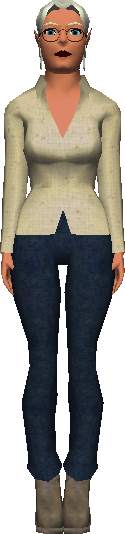

# Banker

<div markdown="1" style="display: flex; align-items: flex-start; gap: 1rem; flex-wrap: wrap; margin-bottom: 1rem;">

{ width=100 loading=lazy }

<div markdown="1" style="flex: 1; min-width: 240px;">

The Banker handles deposits and withdrawals in [Port Town](../world/locations/port-town.md).
Gold deposited at the bank is **not** dropped on death, making the bank the
safest place to store earnings before risking a fight.

Each deposit costs a **5 gold fee**.

See [Death & Respawning](../death.md) for what happens to gold left in your
inventory when you die.

</div>
</div>

## Depositing with `/bankdeposit`

You don't have to open the banker's menu to deposit. The
[`/bankdeposit <number>`](../commands.md#actions) command deposits the given
amount straight from chat:

```
/bankdeposit 100
```

The number is the amount taken from your inventory, and the **5 gold deposit
fee** comes out of that — so `/bankdeposit 100` removes 100 gold and adds
**95 gold** to your bank balance.

A **negative** amount withdraws instead, so `/bankdeposit -100` takes 100 gold
back out of the bank.

!!! tip "Works through walls"
    `/bankdeposit` works even through walls, as long as you are within
    **5 meters** of the Banker. This lets you bank without lining up a clear
    path to the NPC.

!!! warning "Balances over 1,000,000 are rounded"
    Bank balances of a million gold or more are
    [rounded on every transaction](../gold.md#large-balances-1000000-and-above),
    so small deposits and withdrawals can vanish or pay out more than they
    should — the basis of the
    [Money Printer](../reference/exploits/money-printer.md) exploit.

## See also

- [Gold](../gold.md) — the game's currency, pile sizes, and how gold is
  dropped and picked up.
- [`/bankdeposit`](../commands.md#actions) — deposit gold from chat.
- [Money Printer](../reference/exploits/money-printer.md) — free gold from the
  rounding on large balances.
- [Death & Respawning](../death.md) — how carried gold is lost when you die.
