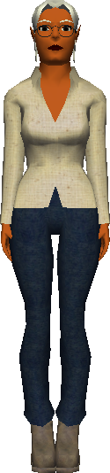

# Blacksmith

{ width=100 loading=lazy }

The Blacksmith is located in [Port Town](../world/locations/port-town.md) and is the
only NPC who can craft weapons, shields, clothing, cloth, and refined metals
from raw materials. Almost every piece of player-made gear in *Age of Time*
passes through the Blacksmith at some point.

## Using the Blacksmith

Talk to the Blacksmith and choose one of four crafting menus: **Weapons**,
**Clothing**, **Cloth**, or **Metal**. Each menu lists recipes with their gold
cost and material requirements; selecting a recipe consumes the materials and
gold from your inventory and produces the listed item.

!!! note "Source data"
    The tables below are transcribed from the live server's craft
    definitions, served from the *Age of Time* master server:

    - <https://master.ageoftime.com/craft/weapons.craft>
    - <https://master.ageoftime.com/craft/clothing.craft>
    - <https://master.ageoftime.com/craft/cloth.craft>
    - <https://master.ageoftime.com/craft/metal.craft>

    Local copies are mirrored in this wiki for posterity (archived
    **2026-05-07**):

    - [`weapons.txt`](../assets/archive/weapons.txt)
    - [`clothing.txt`](../assets/archive/clothing.txt)
    - [`cloth.txt`](../assets/archive/cloth.txt)
    - [`metal.txt`](../assets/archive/metal.txt)

## Weapons

| Item | Cost | Produces | Requirements |
|---|---:|---|---|
| [Crossbow](../items/weapons.md#crossbow) | 500 gold | Crossbow ×1 | 5 Wood, 2 Metal, 1 Metal |
| [Broadsword](../items/weapons.md#sword) | 900 gold | Broadsword ×1 | 5 Metal, 2 Metal, 1 Wood |
| [Shield](../items/weapons.md#shield) | 500 gold | Shield ×1 | 10 Metal, 2 Metal, 1 Metal |

Material choice matters differently by item type:

- [Swords](../items/weapons.md#sword) always deal the same damage and do not gain
  special metal effects.
- [Shields](../items/weapons.md#shield) can trigger special effects based on their
  body metal — see [Shield metal effects](#shield-metal-effects).
- [Crossbows](../items/weapons.md#crossbow) fire bolts faster or slower depending
  on a single metal slot — see
  [Crossbow metals and bolt speed](#crossbow-metals-and-bolt-speed).

## Clothing

All clothing recipes are free (0 gold). Multiple cloth slots let you mix
different colors and patterns; the visual result depends on which Cloth you
feed into each slot. For the full clothing list, recipes, shop locations, and
screenshots, see [Clothing](../items/clothing.md).

## Cloth

All Cloth recipes are free (0 gold) and produce **ClothItem ×5**. Each recipe
combines raw Fiber with one or more dyes to produce a distinct cloth pattern.
The texture list and full recipe table can be found on the [Cloth](../items/cloth.md)
page.

## Metal

Refines raw [Ores](../items/ores.md) into ingots. Steel is the standard
crafting metal; Plutonium is the strongest available. The full metal list,
images, and recipe table can be found on the [Metals](../items/metals.md)
page.

## Shield metal effects

Measured on the official server in **2026-11** by blocking sword hits from
another player and from Orcs with shields crafted from every metal.

- Effects fire **only when the shield actually blocks a hit**: the shield
  must be fully raised and the hit must land on the front half of your body
  (see [Weapons § Blocking](../items/weapons.md#blocking)). Carrying or
  equipping the shield without raising it does nothing.
- They trigger from **a player hitting you with a sword** or from
  **monster contact damage**. Crossbow bolts, thrown knives and spells are
  blocked but never trigger an effect. A charged sword swing triggers the same
  effect as a quick one.
- The effect always lands on the **attacker**.
- The shield's **base** metal (the **10 Metal** ingredient) decides the main
  effect, per the table below. Iron, Steel and Gold only work in this slot.
- The **secondary** metal (the **2 Metal** ingredient) only matters if it is
  **Lead** — see [Secondary metal: Lead](#secondary-metal-lead) below.
- The last metal (the **1 Metal** ingredient) does nothing.

| Base metal | Against players | Against monsters |
|---|---|---|
| Copper | Nothing. | Freezes the monster for about 1 second (it turns blue and stands still), then it comes straight back at you. Has a cooldown of about **4 seconds**: the first block after the cooldown always freezes, blocks during it do nothing. |
| Zinc | Nothing. | Every blocked hit spins the monster to a random direction. If that leaves you out of its view (even a ~30° turn can), it loses you and stands still for about half a second to a second before turning back; if it can still see you it keeps coming. No cooldown. |
| Gold | The attacker drops **0, 1 or 2** of **their own** gold, each equally likely — on average 1 gold per hit, and 2 hits in 3 drop something. Random, no cooldown. An attacker with no gold drops nothing. | The monster drops gold out of thin air (it still drops its normal gold when killed), but each monster gives at most **10** piles, ever. The limit is shared by everyone and never refills; a newly spawned monster starts fresh. |
| Iron | **1** spark shoots out. | Same sparks; they hurt monsters too. |
| Steel | **3** sparks shoot out. | Same sparks; they hurt and can kill monsters. |
| Lead | The attacker is launched about **3.6 m** back and up into the air. | The monster pops about 1 m into the air and about 3 m back. |
| Plutonium | Nothing. | Not tested. |
| Rust | Nothing. | Not tested. |
| Brass | Nothing. | Not tested. |

**Sparks (Iron and Steel):** each spark that connects takes about **3%** of
the target's health — on players and monsters alike — and there is no
cooldown. Sparks spray out in a cone the way **your shield faces**, not
straight at the attacker, so an attacker standing off to the side or at range
mostly dodges them. An Orc died after about 34 spark hits.

**Lead knockback:** pushes the attacker straight **away from you**, even if
they attack from the side, and adds to their own movement (an attacker
running in gets knocked back less). No cooldown.

!!! tip "Walking into a monster while blocking"
    Walking into a monster with your shield raised can register its hit
    **twice**, so the effect fires twice at once: a Lead shield knocks it
    about 9.5 m back, and an Iron or Steel shield fires two bursts of sparks.

!!! tip "Copper and Zinc shields can break monster spawning"
    The lose-target effect from Copper and Zinc shields can be exploited to
    stop monsters spawning around you entirely — see
    [Monster Spawn Break](../reference/exploits/spawn-break.md).

### Secondary metal: Lead

Supplying **Lead** as the secondary (**2 Metal**) ingredient adds a
**smaller** knockback (about **2.1 m** instead of 3.6 m) **on top of** the
base metal's effect, so the shield triggers both at once — for example a
Gold/Lead shield drops the attacker's gold *and* knocks them back.

This also works on **Iron** and **Steel** bases: they keep all their sparks
and gain the knockback. Extra Lead does not stack — a shield with Lead in
every slot knocks exactly as hard as one with Lead only as the base. Lead as
the last (1 Metal) ingredient does nothing.

!!! note
    Sword damage does not change with metal; only shields and crossbows
    are affected by the metals they are made from.

## Crossbow metals and bolt speed

This data was measured directly by logging bolt spawn velocities in-game
for the same crossbow crafted from every metal
(tested **2026-07**).

- Only the metal supplied for the **2 Metal** ingredient matters. The
  **1 Metal** ingredient and the **Wood** are purely cosmetic.
- The metal changes **only** the bolt's muzzle velocity — and therefore how
  far the crossbow shoots. Damage and reload time are identical for all
  materials.
- Ammo type does not affect speed or range: Steel Bolts and Exploding Bolts
  fire at identical speeds for a given crossbow. The ammo only changes what
  the bolt does on impact.

| Metal (2 Metal slot) | Bolt muzzle velocity |
|---|---:|
| Plutonium | 200 |
| Steel | 100 |
| Gold | 75 |
| Iron | 50 |
| Brass | 35 |
| Copper | 35 |
| Rust | 20 |
| Zinc | 20 |
| Lead | 5 |

Muzzle velocity spans **40×** from lead (5) to plutonium (200), and range
grows at least linearly with velocity, so a plutonium crossbow shoots
dramatically farther than anything else — twice as fast as steel, the next
best. Rust/zinc and brass/copper tie exactly.

!!! note
    Pick your ammo for the on-impact effect (plain vs. explosive) and your
    **2 Metal** ingredient for the range — the two are completely
    independent.
