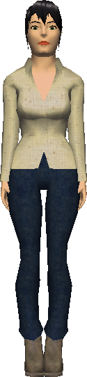

# Police (Marshal)

<div markdown="1" style="display: flex; align-items: flex-start; gap: 1rem; flex-wrap: wrap; margin-bottom: 1rem;">

{ width=100 loading=lazy }

<div markdown="1" style="flex: 1; min-width: 240px;">

The friendly NPC inside the [Police Station](../world/locations/port-town.md#police-station)
is the **Marshal**. They run the police force, hand out paychecks, accept
fines, publish the wanted list, and recruit new officers.

For the actual law system, crime definitions, arrests, jail, and demerits,
see [Police Mechanics](../police-mechanics.md).

</div>
</div>

## Talking to the Marshal

Approach the Marshal and press <kbd>E</kbd> to bring up the dialogue. The
Marshal greets you with:

> Hello *&lt;your name&gt;*, this is the police station.  How can I help you?

The following options are available:

| Option | Outcome |
|---|---|
| What are the laws? | *"There are many laws.  Please take a complementary Law Guide from the stand in the corner."* See [the Law Guide stand](#the-law-guide-stand). |
| I want to become a police officer. | [Enlists you](#becoming-a-police-officer) if you qualify. |
| I want my paycheck. | Pays out your [share of recent fines](../police-mechanics.md#paychecks), e.g. *"Your pay comes to: 206 gold."* Civilians get *"Hey! You're not even a police officer."* |
| I want some information on criminals. | Asks about [wanted players](#information-on-criminals). |
| I would like to pay a fine. | Lets you [pay off your demerits](#paying-a-fine). |

## Information on criminals

The Marshal asks *"What would you like to know?"* and offers two questions:

- **Who are the most wanted criminals?** — *"The 10 most wanted:"* followed by
  the characters with the most demerits, online or not, highest first. The
  list is long enough that the game cuts it off after about seven names.
- **Are there any criminals on right now?** — lists every online player
  with **60 or more** demerits (the [wanted](../police-mechanics.md#demerits-at-a-glance)
  line), with their demerits first:

    ```text
    Online Criminals:
       200    SomePlayer
        60    AnotherPlayer
    ```

Officers should check this before swinging the baton: hitting anyone not on
the list is a [crime](../police-mechanics.md#baton-hits-and-crimes).

## Paying a fine

With demerits, the Marshal quotes the whole fine and asks you to confirm
(this example is an officer's fine, at 3 gold per demerit):

> Your fine for 15 demerits will be 45 gold.  Would you like to pay?

Choosing **Yes** takes the gold and replies:

> Payment recieved.  You now have 0 demerits.  Try to stay out of trouble.

Choosing **No** gets *"Pay the fine or do the time.  Watch your back."*, and
choosing **Yes** without enough gold gets *"You don't have enough money."*

With no demerits:

> You don't have any demerits, theres no need to pay a fine.

(The quotes keep the game's own spelling.) See
[Police Mechanics § Paying fines](../police-mechanics.md#paying-fines) for the
price per demerit.

## Becoming a police officer

Selecting **"I want to become a police officer."** has four possible
outcomes:

| Situation | Marshal's response |
|---|---|
| You qualify | *"Congratulations, you're now on the police force.  Please review the "Police Law Guide" for specifics.  Try not to screw up."* |
| Less than **1 hour** of play time (check with [`/playtime`](../commands.md#system)) | *"Sorry, we don't take newbies."* |
| You're already on the force | *"You already are a police officer!"* |
| You were removed from the force before (arrested as an officer) | *"We already gave you a chance, you blew it."* That character can never rejoin (see below). |

On enlistment the Marshal hands you the **[Police Baton](../items/weapons.md#police-baton)**
and the **Police Law Guide** from the shelf behind him (they flicker on the
shelf as he takes them). The Police Law Guide's full text is on
[Police Mechanics](../police-mechanics.md#police-law-guide). The shirt, pants
and shoes on the shelf are only decoration: you can't take them and you don't
get a uniform.

!!! note "Starting over after losing your badge"
    The only way to become an officer again is to **overwrite your
    character**: on the new-character screen enter the same name and
    password and confirm that you want to overwrite it. You start from
    scratch (items, gold and play time are gone; only your mail is kept), so
    you need another hour of play time before the Marshal will take you.

## The Law Guide stand

The **Citizen's Law Guide** sits spinning on a stand in the corner of the
police station. Look at it and press <kbd>E</kbd> to take one. It's a one-time
pickup: trying again gives *"You already did this quest."* Ask the Marshal
*"How do I read the guide?"* and he explains: open your inventory
(<kbd>I</kbd>), the **Items** tab, select **Citizen's Law Guide** and click
**Use/Equip**.

## Quest items

The Police Baton, the Police Law Guide and the Citizen's Law Guide are
**quest items**: you can't drop them. Trying gives *"You cannot discard quest
items."*

## Service limits

You are permanently removed from the force if:

- You are arrested and jailed, or
- You accumulate more than 150 demerits. (In practice this does nothing on
  its own: an officer at 160 demerits was still on the force. Getting
  **arrested** is what removes you.)

When an officer is arrested they get **Corruption** (90 demerits), the
message *"You have been removed from the police force."*, and lose their
Police Baton and Police Law Guide.

You cannot re-enlist if:

- You currently have more than 60 demerits, or
- You have served more than 150 cumulative seconds in jail.
