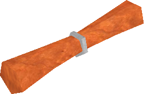

# Police Mechanics

The law system in *Age of Time* controls demerits, arrests, fines, jail time,
and police paychecks. The [Marshal](npcs/police.md) handles the NPC dialogue;
this page documents the mechanics themselves.

## Citizen's Law Guide

{ width=220 loading=lazy }

Selecting **"What are the laws?"** from the Marshal prompts:

> There are many laws. Please take a complementary Law Guide from the stand
> in the corner.

The parchment reads:

```text
THE LAW:

1. No Public Nudity
2. No Throwing Knife Theft
3. No Cursing
4. No Spamming
5. No ALL CAPS
6. No Horse Theft

These laws are to be enforced by the people.

Demerits shall be issued for each violation of the law. When a citizen
accumulates 60 or more demerits, they may be apprehended by an officer of
the law and jailed for a period of 1 second for each demerit.

If you have less than 150 demerits, you can pay a fine to remove your
demerits. Civilians pay 5 gold per demerit, Police officers pay 15 gold
per demerit.

If you leave the game or log out while stunned by a police baton, you
will be automatically jailed for any crimes you have committed

This document is subject to magical change without notice.
```

## Police Law Guide

{ width=220 loading=lazy }

On enlistment you receive a second parchment with arrest instructions and
crime definitions:

```text
How To Arrest Someone:
--------------------------------------------
1. Make sure the perp has at least
   60 demerits.  Check with the Marshal.
2. When you are both inside a town area,
   hit the perp with your police baton.
   This will stun them.
     TIP: The harder you hit someone,
     the longer they will be stunned.
     After you knock them down, give them
     a good hard hit to make sure they
     don't get away.
3. While they are stunned, run up to them
   and press ACTION (default E) to pick
   them up.
4. Carry them to the police station and
   throw them into the bin next to the
   Marshal's cage by pressing STOP ACTION
   (default CTRL E)

+------------------------+---------+
| Crime Name             | Demerits|
+------------------------+---------+
| Throwing Knife Theft   |    5    |
| Public Nudity - 1st    |   60    |
| Public Nudity - Repeat |   90    |
| Cursing                |   10    |
| Spamming               |   20    |
| All Caps               |   20    |
| False Arrest           |   15    |
| Police Brutality       |   30    |
| Corruption             |   90    |
| Murder                 |  140    |
| Horse Theft            |   80    |
| Aiding Escape          |   60    |
+------------------------+---------+

Definitions:
--------------------------------------------
Throwing Knife Theft (500d max) -
     Picking up a knife that has been
     thrown by another person.

Public Nudity (1000d max) -
     Removing of the clothes outside of
     the inn rooms.

Cursing (200d max) -
     Using these words in global chat:
     shit, fuck, nigger, asshole, cunt

Spamming (200d max) -
     Saying the same thing more than once
     in a row within 2 seconds in
     global chat.

All Caps (200d max) -
     Talking in all capital letters in
     global chat.

False Arrest -
     Clubbing someone with your police
     baton who does not have more
     than 60 demerits.

Police Brutality -
     Clubbing someone REALLY HARD with
     your police baton who does not have
     more than 60 demerits.

Corruption -
     Being arrested as a police officer.

Murder -
     Killing an innocent person who has
been stunned by a police baton.

Horse Theft -
     Driving a horse that does not belong
     to you.  Community horses are simply
     labeled "Horse"

Aiding Escape -
     Non-police carrying a stunned
criminal.  (Must be stunned in the
act)

--------------------------------------------

Losing Police Status:
--------------------------------------------
You will permantly removed from the police force if:
 - You are arrested and jailed
 - You accumulate more than 150 demerits

You cannot become a police officer if:
 - You currently have more than 60
   demerits
 - You have served more than 150 seconds
   in jail
--------------------------------------------
Your Paycheck:
--------------------------------------------
You do not get paid for jailing criminals

When someone pays a fine, it is divided
up among all of the on-duty cops.  This
is your paycheck.
--------------------------------------------
```

## Demerits at a glance

| Crime | Demerits | Cap |
|---|---:|---:|
| Throwing Knife Theft | 5 | 500 |
| Cursing | 10 | 200 |
| False Arrest | 15 | — |
| Spamming | 20 | 200 |
| All Caps | 20 | 200 |
| Police Brutality | 30 | — |
| Aiding Escape | 60 | — |
| Public Nudity (1st offence) | 60 | 1000 |
| Horse Theft | 80 | — |
| Public Nudity (repeat) | 90 | 1000 |
| Corruption (officer arrested) | 90 | — |
| Murder | 140 | — |
| Arrest (community service, officers) | **−15** | — |

A player with **60 or more demerits** is *wanted* and can be arrested;
exactly 60 already counts. (The Law Guide's crime definitions say *"more than
60"*, but a player with exactly 60 is treated as wanted.) The **cap** column
is how high that crime can take your total: for the chat crimes, once you
have **200 demerits** a message that would be Cursing, All Caps or Spamming is
simply **not posted** (no crime, no message), which is why chat-heavy players
sit at exactly 200.

When you commit a crime the game tells you in chat, for example:

> You have commited a crime. (All Caps)

(The game's spelling.) Measured on the official server:

- **All Caps** gives 20 demerits for every all-caps message. Three of them
  are enough to make you wanted. Messages 8 seconds apart did not add
  Spamming on top.
- **Arresting someone** takes 15 demerits *off* the arresting officer
  (*"You have performed community service. (Arrest)"*). This can take an
  officer below zero: *"You now have -15 demerits."* It bottoms out at
  **−30**, so at most two arrests' worth of credit can be
  banked against future crimes.

## Baton hits and crimes

How a [Police Baton](items/weapons.md#police-baton) hit is treated depends on
the target's demerits:

| Target | Stun | Crime for the officer |
|---|---|---|
| **Wanted** (60+ demerits) | Full: up to about 36.5 s per hit, 47 s stacked | None |
| **Innocent** (under 60), normal hit | Same length per charge, but never more than **10.4 s** left | **False Arrest** (15) |
| **Innocent**, full-charge hit (charged about 2.1 s or more) | Same 10.4 s limit | **Police Brutality** (30) *instead of* False Arrest |

- **Every hit is its own crime.** Two quick hits on an innocent player are
  two False Arrests (30 demerits).
- Only the officer is told: *"You have commited a crime. (False Arrest)"* or
  *"(Police Brutality)"*. The player who was hit gets no message.
- Innocent players are still stunned, and repeat hits still add up, but only
  to 10.4 s — so they never get the thickest cloud of stars.
- It makes no difference whether the innocent target is a civilian or
  another officer.
- "REALLY HARD" in the Law Guide means a **fully charged** hit. There is no
  sound or animation when the charge is full, so you have to count about
  2 seconds.
- Hitting monsters is never a crime.

### Chat crimes in detail

Only **global chat** (<kbd>T</kbd>) is checked; local chat never gives a
crime.

- **Cursing (+10):** any of the listed words *anywhere* in the message, in
  any case: "shitty" and "FUCKING" count, "grass hole" doesn't. Splitting
  the word up ("s.h.i.t", "sh'it", "s h i t") isn't caught.
- **All Caps (+20):** messages longer than 3 characters that are mostly
  capitals. Symbols like `!@#$%^&*` count as capitals, while lowercase
  letters, digits and `.` `?` count against, and a lowercase letter counts
  double. "WXYZ", "!!!!" and "ABC12" are All Caps; "ABcd", "HELLO world" and
  "yes!!!!" aren't. One all-caps swear word ("FUCK") is two crimes, 30
  demerits.
- **Spamming (+20):** sending the **same message as your last one** (any
  capitalisation) within about **4 seconds**. The repeat isn't posted.
  Changing a digit or a comma makes it a different message. Adding spaces to the
  end doesn't (the game ignores them), but adding them to the start does. Local
  chat is ignored here: saying it in local chat in between doesn't help, and
  repeating a global line in local chat isn't spam.
- Several curse words in one message are still **one** Cursing crime (+10).
  Sending the same message three times quickly is Spamming twice.
- A crime that would take you past **200** stops at 200, and that message is
  still posted (190 + All Caps → 200). After that, see the cap above.
- In jail, global chat is refused before it is checked, so it can't give a
  crime.
- The server removes `"` `~` and `` ` `` from chat messages.
- **Flood protection** (no demerits): a 5th message within 10 seconds blocks
  you for 10 seconds with *"FLOOD PROTECTION: You must wait another 10
  seconds."* Local chat counts towards it too. See
  [How chat works](getting-started.md#how-chat-works).

### Public nudity in detail

- You count as naked when your **chest is uncovered** (no shirt and no bra) or
  your **bottom is uncovered** (no pants and no underpants). Taking off just
  your shirt or just your pants is fine.
- You're charged **the moment** you become naked: **60** demerits the first
  time, then **90** for every charge after that.
- While you stay naked you're charged again about **every 47 seconds**.
  Getting dressed stops it.
- Undressing again within about **26 seconds** of a charge doesn't charge you
  straight away, but the game then waits however long it had already been and
  checks again (so the wait keeps doubling until 26 seconds have passed). In
  practice: strip again 15 seconds after a charge and you're charged 15 seconds
  later; strip again 10 seconds after and you're charged about 30 seconds later.
- It stops at **1000** demerits: the charge that would go past 1000 only takes
  you to 1000, and after that you aren't charged at all.
- Inside the **inn rooms** it isn't a crime: the Driftwood Inn in Port Town,
  The Tavern, and one more house with beds. The lobby and the hallways are
  public. What counts is being inside the room itself: standing right on the
  other side of a room's wall still gets you charged, and so does standing
  just outside a room's **closed** door (with the door open, the doorway
  counts as part of the room).

## Arrest mechanics

1. **Stun** the perp with the [police baton](items/weapons.md#police-baton).
   The harder the hit, the longer the stun.
2. **Pick up** the stunned body with <kbd>E</kbd> (you have to be within
   about 3 m). Picking someone up puts away the item you were holding.
3. **Carry** them to the police station. The stun keeps counting down while
   you carry them.
4. **Carry them into the small box room** (the "bin") next to the Marshal's
   cage. The moment you step over its ledge with them in your arms, they are
   jailed: everyone sees *"&lt;perp&gt; was captured by &lt;you&gt; and jailed
   for 1:00!"* and you get *"You have performed community service.
   (Arrest)"*. You don't need to drop them. (The guide says to throw them in
   with <kbd>Ctrl</kbd>+<kbd>E</kbd>; walking in while carrying them is
   enough.)

A wanted player who walks into the box **on their own** is jailed too, but a
wanted **police officer** walking in by themselves is not: officers are only
jailed when carried in.

Jail time is **1 second per demerit** the perp is carrying when arrested
(60 demerits = 1:00).

Successful arrests also remove **15 demerits** from the arresting officer as
a kind of community-service credit, down to a minimum of **−30**.

### Who gets the credit

The game remembers **the last person who picked the perp up**, and that
person gets the arrest whenever the perp ends up in the box, even if they
walk in by themselves later.

- **Picking them up sets it**, whether they were stunned or a corpse.
  Stunning someone without picking them up doesn't count.
- **It doesn't wear off.** You still get the credit if they walk in more than
  a minute after you dropped them, even if they died and respawned in
  between, and even if **you** died in the meantime.
- **The next person to pick them up takes it over.**
- **It's cleared** when the perp is jailed, or when the perp logs out or
  back in.
- **It belongs to your game connection, not your character.** If you log
  out before they're jailed, the arrest goes to your logged-out session
  (*"captured by &lt;Logged Out&gt;"*) and you get nothing, and if you log in
  as another character, that character gets it. If you quit the game,
  nobody gets it.
- With nobody to credit, the message is just *"&lt;perp&gt; was captured and
  jailed for 1:00!"*

!!! warning "Carried players can walk off when the stun ends"
    When the stun runs out the player gets control back but stays in your
    arms until they press jump; then they are let go on the spot. While still
    stunned, jumping does nothing but show *"You have been stunned."*. If the
    stun is running low, hit them again — each hit adds to the time left.

!!! note "Stunning outside towns"
    The Police Law Guide says *"When you are both inside a town area, hit the
    perp with your police baton."* In practice, the baton works anywhere. You
    can stun a wanted player out in the wilderness and still carry them back
    to Port Town to finish the arrest.

!!! note "Someone else carrying your perp"
    Anyone can pick up a stunned player, not just police, and picking one up
    is not a crime on its own. If a non-officer is carrying your perp:

    - Hitting the **carrier** stuns them and makes them drop the perp, but it
      counts as hitting an innocent player: **you** get False Arrest (15) and
      the carrier gets nothing. If the carrier is wanted, it's a normal legal
      hit. Either way the carrier gets no extra demerits. *Aiding Escape*
      doesn't seem to work: stunning a carrier "in the act", as the law guide
      describes, gave no demerits in Port Town, the Arena or The Wilderness,
      whether the same officer or a second one stunned the carrier.
    - Hitting the **perp** while they are being carried knocks them out of the
      carrier's arms and adds to their stun. The carried player sits up at
      the carrier's head, so a swing at head height hits the perp, and a
      swing lower down hits the carrier.

### Logging out while stunned

Logging out (or quitting) while stunned counts as **being arrested by the
officer who stunned you**:

- The normal 5-second logout countdown still runs; being stunned neither
  stops nor shortens it.
- When it ends, a wanted player gets *"You have been jailed for 1:00"* (their
  sentence), their zone in the player list changes to **Jail**, and everyone
  sees *"&lt;player&gt; was captured by &lt;officer&gt; and jailed for 1:00!"*.
- The officer is credited with the arrest: *"You have performed community
  service. (Arrest)"* and 15 demerits off.
- A player with **no demerits** can log out of a stun with no consequence.
  When they log back in they are where they logged out and no longer stunned.

!!! note "Respawn shortcut to jail"
    If a wanted player is **dead**, is being **carried by a police officer**,
    and then chooses **Respawn**, they are jailed immediately. Logging out
    instead of respawning does **not** trigger this shortcut.

## Throwing knife theft

A thrown knife belongs to the player who threw it for **30 seconds** after it
drops to the ground. During that window, picking it up yourself counts as
**Throwing Knife Theft**. Knives are picked up with the action key
(<kbd>E</kbd>), not collected automatically by touching them.

Once the knife shows a **`V`** above it, that temporary ownership has expired
and anyone can take it freely. A knife **dropped from someone's inventory**
(rather than thrown) is never protected and shows the `V` straight away.
Thrown knives left on the ground disappear after **2 minutes**; knives dropped
from an inventory don't. See
[Weapons § Throwing Knife](items/weapons.md#throwing-knife) for more.

## Paying fines

If you have **fewer than 150 demerits** you can choose **"I would like to pay
a fine."** from the [Marshal](npcs/police.md#paying-a-fine) to wipe them all
at once.

| Payer | Cost per demerit |
|---|---:|
| Civilian | **1 gold** (measured: 60 demerits cost 60 gold) |
| Police officer | **3 gold** (measured: 15 demerits cost 45 gold, 30 cost 90) |

At 150+ demerits, fines are no longer accepted and you must serve jail time.
The Marshal just says *"Hah!  We don't let scum like you get off with just a
fine."*

!!! note "Law Guide numbers are outdated"
    The parchment still says **5** and **15** gold per demerit. On the
    official server a civilian pays **1** gold per demerit and an officer
    pays **3**.

## Paychecks

Selecting **"I want my paycheck."** from the Marshal pays out your share of
recent fines.

- Officers are **not** paid for making arrests.
- Whenever someone pays a fine, every officer who is **logged in** at that
  moment gets **the fine ÷ (number of officers online + 2)**. Measured: a
  60-gold fine paid 15 each to two officers, 20 to a lone officer; a 90-gold
  fine paid a lone officer 30. (The other two shares go to nobody.)
- When an **officer** pays their own fine (3 gold per demerit), they count as
  one of the officers and get a share back: a 270-gold fine with three
  officers online paid all three, including the one who paid, 54 each.
- Pay builds up until you collect it, even across logouts. Asking with
  nothing owed gets *"Sorry, you haven't earned any pay yet."*

## Serving jail time

Jail time must be served — although see the
[Jail Escape](reference/exploits/jail-escape.md) exploits.

- You serve it in the **jail cell under the Port Town police station**. Your
  zone in the player list shows **Jail**.
- On arrival you get *"You have been jailed for 1:00"* and *"Jail time
  remaining: 1:00"* (the sentence is shown as minutes:seconds), then a
  *"Jail time remaining"* reminder every **30 seconds**.
- Your name tag shows the time left, for example **`name | 1:00`**, updated
  on the same 30-second beat.
- **The clock only runs while you are logged in.** Logging out with time owed
  pauses it; when you log back in you are put straight back in the cell with
  the same time left.
- When the time is up you get *"You're free!"* and are moved just outside the
  cell.

## Jail by IP

!!! danger "Same-IP jailing"
    Jail follows your **IP address**, not just your character. While one of
    your characters owes jail time, **any other character that logs in from
    the same IP is jailed for the time it has left — even a brand-new
    character the moment it is created, and even while the jailed character
    is online serving its time.** Anyone else in your household on the same
    connection is caught by this too.

- It is a **copy**, not a transfer: serving the sentence on another
  character does not reduce it. The original character still owes all of it
  when it next logs in.
- Once the **original** character has served its sentence, the link is
  gone: a character created afterwards from the same IP was not jailed.
- This presumably includes police officers on the same IP, and being jailed
  costs an officer their badge: an arrested officer gets *"You have been
  removed from the police force."* and loses their baton and Police Law
  Guide.
- Community reports say the link expires on its own after about
  **30 minutes**; this has not been confirmed.
