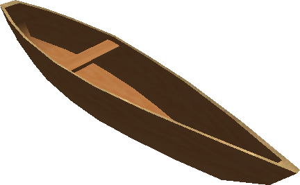

# Tips & Secrets

Miscellaneous information about *Age of Time* — rumored mechanics, easter
eggs, world events, and known workarounds.

## Events

### Meteor showers

Occasionally, meteors will fall from the sky carrying [Autunite](items/ores.md).
This is the only way to obtain Autunite — and therefore the only way to
ultimately produce Plutonium.

If a meteor-shower meteor kills a player, the server reports it as a monster
kill, for example: `<player name> was killed by a monster!`

What one shower looks like (one shower recorded in full, **2026-11-24**;
numbers will be refined as more are recorded):

- **No warning:** there is no server message — the meteors just start
  falling.
- **About 1,000 meteors in about 41 seconds** (1,024 recorded, a steady
  ~25 per second).
- **Over Port Town:** each meteor starts high in the sky at a random spot
  inside a 200 × 200 m square covering Port Town and its surroundings, and
  comes down fast at a slight diagonal (drifting the same way every time).
  The meteor itself is a fiery streak with no solid shape.
- **Impact:** on land it bursts into a smoky explosion with sparks and a
  bang; meteors that fall into the sea make a water splash instead.
- **Autunite:** about **7%** of meteors leave one Autunite ore exactly where
  they hit (72 of 1,024) — so a shower yields roughly 70 Autunite spread
  across Port Town, including some in the water. The ore can roll after
  landing, and it **disappears about 30 seconds after it lands**, so you
  have to be there and grab it quickly.
- **How often showers happen** is not known yet, but they are rare: after the
  recorded shower, none came in the next 13 hours, nor in the first 5½ hours
  after the following server restart.

### Rain and snow

Storms come and go about five times an hour across the whole world, and about
1 in 13 is snow. See [Weather](world/weather.md) for how long they last and how
often they start.

### Boats

{ width=220 loading=lazy }

Boats used to appear in the game, but only when **Badspot** spawned them
manually. They were never a normal player-accessible feature, and it has been
a very long time since anyone has reported seeing one live in-game.

## Tricks

### Orbit camera stealth

While your player is in the orbit camera, [enemy NPCs](enemies.md) around
your body will not notice you until you exit the camera. This makes it a safe
way to go AFK or stop and type a long message out in the wilderness, where
monsters would normally aggro onto you.

Enter the orbit camera either way:

- Press <kbd>F8</kbd> ([Camera & view controls](getting-started.md#camera-view)), or
- Run `#!torquescript commandToServer('dropCameraAtPlayer');` from the console
  ([Server commands](reference/server-commands.md)) — the same thing.

Limitations:

- It only prevents enemy NPCs from **noticing** you. If a monster is already
  chasing you, entering the orbit camera will not shake it off.

## Easter eggs

| Trigger | Effect |
|---|---|
| `/cast sandwich` | Prints: *"You cast yourself a sandwich. Tastes Good."* |
| `/cast boobs` | Gradually grows the caster's bust from minimum to maximum size. |
| <kbd>Ctrl</kbd>+<kbd>K</kbd> while in Jail | Prints: *"You can't get out that easily."* |
| Typing the letter `U` alone in a sentence | Prints: *"Learn How to Type."* |
| Sending a chat message consisting only of `Badspot` (ignoring leading/trailing whitespace) | Message is blocked; the chat prints *"I am not your fucking mother. I am not going to say 'yes dear?' every time you say my name. Just ask the damn question."* in red. |

!!! note "Why the badspot filter exists"
    **Badspot** is the screen name of *Age of Time*'s creator, Eric Hartman.
    Whenever he logged onto the server, players would spam his name to get
    his attention; the auto-reply was added so he didn't have to deal with
    it. See [About the Game](about.md) for more on the game's history.

## Bug fixes / workarounds

### Blue monsters

If monsters render as solid blue, open **Adv. Graphics** and **uncheck
Environment Maps under Geometry**.
