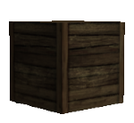
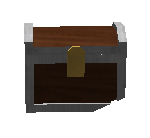
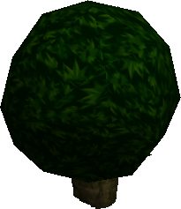
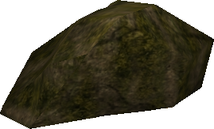
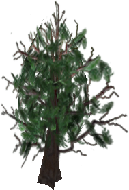

# World Objects

Things that exist in the world rather than in a player's inventory — the
breakable resource nodes and trees below, plus items players have dropped on
the ground.

## Dropped items

When you drop an item from your inventory it stays on the ground as a world
object. The world keeps at most **1001 dropped items** at any one time. This is
a single **global** limit across the entire map — it is not counted per-area or
per-zone, and distance plays no part.

Dropping one more item than the cap (the 1002nd) deletes the **oldest** dropped
item still on the ground, wherever it happens to be — first in, first out. In
one test, a player dropped a single dye in the [Woods](world/locations/woods.md),
then dropped 1001 dyes in [Port Town](world/locations/port-town.md); the moment
the count went over the cap, that first dye in the Woods disappeared.

Dropped items are also **never saved to the server** — they exist only in the
running world. When the server shuts down or restarts, every item and pile of
gold lying on the ground is lost.

## Resource nodes and breakables

- { width=64 } **Crate** — found in
  dye-bearing locations rather than all areas. Drops Gold and the area's Dye
  colors; in [Auric Fields](world/locations/auric-fields.md) (only) about 1 in
  107 crates spawns lit Dynamite instead. See [Crates](crate-rates.md) for
  spawn and respawn behavior, plus measured per-zone drop rates.

- { width=64 } **Dynamite
  Chest** — very rare, found near Port Town. Drops about 5 active sticks of
  Dynamite. Historically these used to drop large amounts of Gold, but the
  reward was changed after players began using scripts to locate and farm them
  too efficiently.

- { width=64 } **Shrub** — break to drop
  [Fiber](items/fiber.md). Toss Fiber onto a surface to grow a new Fiber plant
  for later harvesting; see [Fiber & Fiber Plants](items/fiber.md) for the
  growth time and harvest rules.

- { width=64 } **Large Rock** —
  break to drop [Ores](items/ores.md).

## Tree

Trees are world objects that you blow up with [Dynamite](items/index.md#general-items)
to get wood plank types. Only tree objects that show a visible **health bar**
when targeted are valid resource trees and will drop wood. Different tree
models do **not** all share the same wood drop table. For the resulting wood
items, see [Wood Types](items/wood-types.md).

### Maple `Sharp_Maple01`

{ width=260 loading=lazy }

Shape file:
`base/data/shapes/Sharp_Trees/Trees/Maples/Sharp_Maple01.dts`

Wood drops: Maple

### Maple `Sharp_Maple05`

{ width=260 loading=lazy }

Shape file:
`base/data/shapes/Sharp_Trees/Trees/Maples/Sharp_Maple05.dts`

Wood drops: Walnut

### MonkeyPod `sharp_mp04`

{ width=260 loading=lazy }

Shape file:
`base/data/shapes/Sharp_Trees/Trees/MonkeyPod/sharp_mp04.dts`

Wood drops: Cork, Flakeboard

### Poplar `Sharp_Poplar10`

{ width=260 loading=lazy }

Shape file:
`base/data/shapes/Sharp_Trees/Trees/Poplar/Sharp_Poplar10.dts`

Wood drops: Beech, Teak

### White Pine `Sharp_WhitePine01`

{ width=260 loading=lazy }

Shape file:
`base/data/shapes/Sharp_Trees/Trees/White_Pine/Sharp_WhitePine01.dts`

Wood drops: Pine

### Pear `Sharp_Pear05`

{ width=260 loading=lazy }

Shape file:
`base/data/shapes/Sharp_Trees/Trees/Pears/Sharp_Pear05.dts`

Wood drops: Cherry

### Oak `Sharp_Oak02`

{ width=260 loading=lazy }

Shape file:
`base/data/shapes/Sharp_Trees/Trees/Oaks/Sharp_Oak02.dts`

Wood drops: Oak

### Cedar-family tree

{ width=260 loading=lazy }

Shape files:
`base/data/shapes/Sharp_Trees/Trees/Cedar_Cypruss/Sharp_Cedar08.dts`
`base/data/shapes/Sharp_Trees/Trees/Cedar_Cypruss/Sharp_Cedar09.dts`

Wood drops: Not yet documented

### Swamp Cyprus `Sharp_SwampCyprus02`

{ width=260 loading=lazy }

Shape file:
`base/data/shapes/Sharp_Trees/Trees/Cedar_Cypruss/Sharp_SwampCyprus02.dts`

Wood drops: Not yet documented

## Unknown or poorly understood

### Swamp orb

The [Swamp](world/locations/swamp.md) contains a large white orb-like object
with very high HP.

- It can be destroyed.
- It respawns in the same spot after a short time.
- It is not known to drop Gold or serve a confirmed gameplay purpose.
- Players sometimes hide inside it by breaking it and waiting for it to
  respawn over them.
