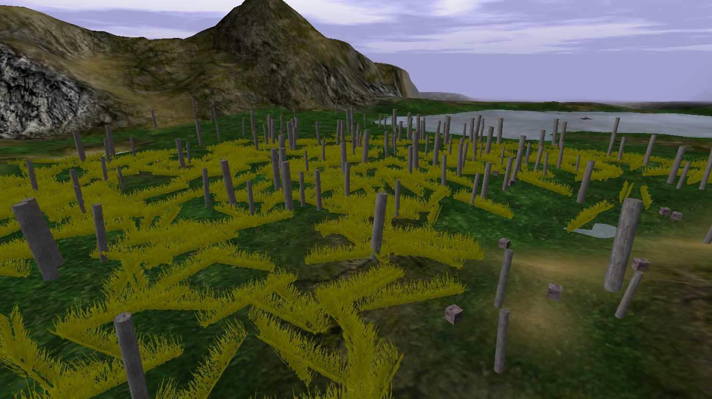
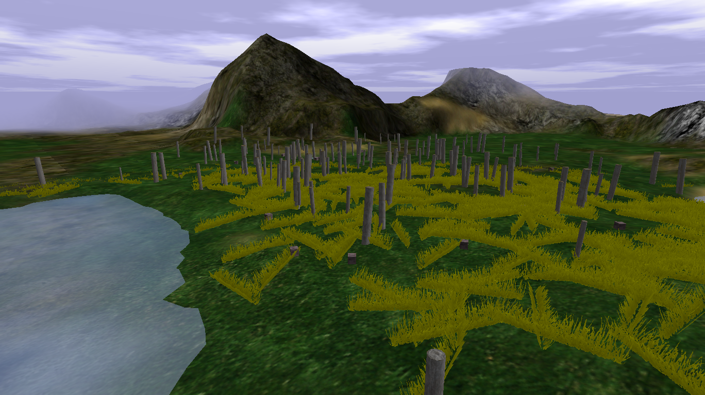

# Auric Fields

{ width=400 loading=lazy }

A field of yellow grass containing Yellow Dye crates.

The field holds **20 crates on 1-second individual respawns** — tied with the
[Woods](woods.md) for the best gold farming in the game. Crates drop Gold,
Yellow or Bright Yellow Dye, or occasionally lit Dynamite (~1 in 107 crates —
Auric Fields is the **only** area whose crates spawn dynamite). See
[Crate Rates](../../crate-rates.md#crate-rates) for the full measured drop table.

Crates can spawn on top of the dead logs lying in the field, and now and then
inside a hollow one, where it is hard or impossible to reach.
The flat patch in the middle of the field never gets crates (crates never
spawn on perfectly flat ground).

[:material-map-search: View on the world map](../../map/index.html#-1277.7,586.5,1.2){ .md-button }
[:material-video-3d: Explore in 3D](../../map/3d/index.html#-1422,355,418,-1277.7,586.5,216){ .md-button }

## Screenshots

- { loading=lazy data-gallery="auric-fields" }

    **Another view from above** - a second overhead angle of the field.

