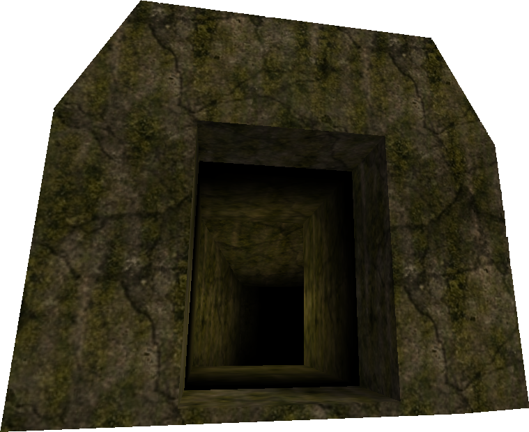
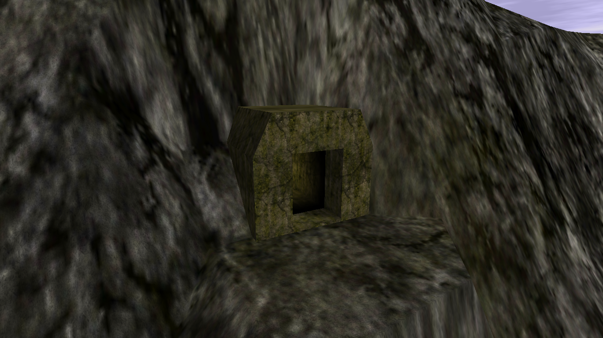
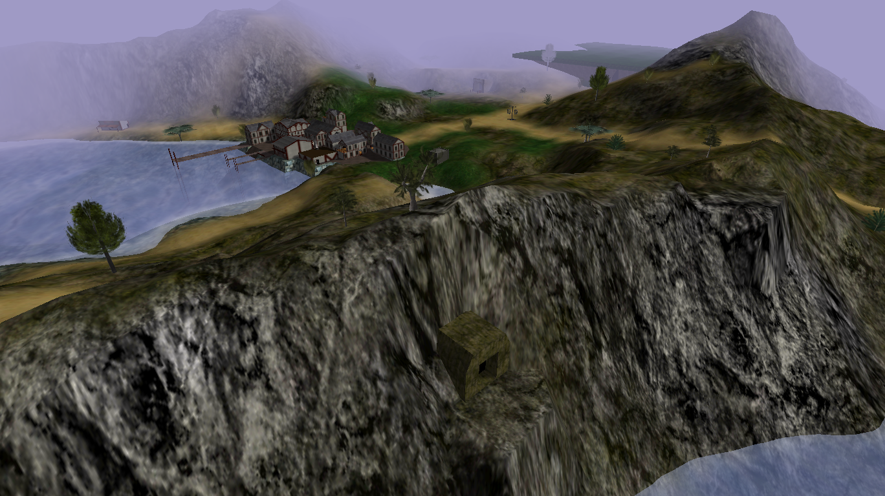

# Cave

{ width=400 loading=lazy }

A short, pitch-dark cave that ends in a deep pit.

[:material-map-search: View on the world map](../../map/index.html#575.9,72.4,1.2){ .md-button }
[:material-video-3d: Explore in 3D](../../map/3d/index.html#431,-159,448,575.9,72.4,246){ .md-button }

## The pit

The floor of the pit holds a **trigger** (a box that runs code when a player
enters or leaves it). When a player steps into it, an [Orc](../../enemies.md)
spawns down in the pit, notices the player, and starts attacking. Step back out
of the trigger and the Orc despawns.

The trigger does **not** cover the entire floor of the pit — there is room to
stand along the north-west side, just outside it. That gap is the basis of the
[Monster Spawn Break](../../reference/exploits/spawn-break.md) exploit, which
repeatedly steps in and out of the trigger to disable monster spawning around
the player.

## Screenshots

- { loading=lazy data-gallery="cave" }

    **View from outside** - the Cave entrance seen from the outside.

- { loading=lazy data-gallery="cave" }

    **With Port Town in view** - the Cave with [Port Town](port-town.md)
    visible in the background.

